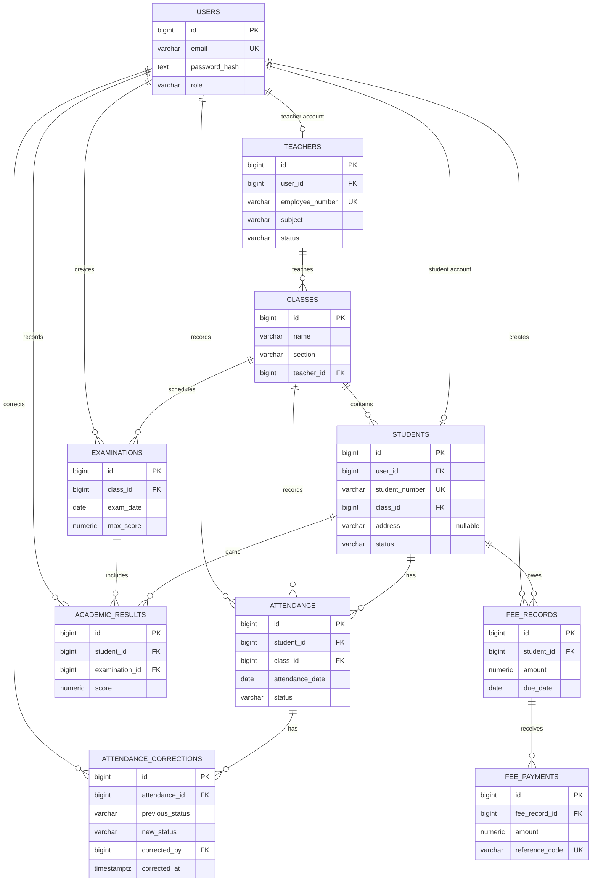

# CodSoft Task 1 — Student Management System

[](https://react.dev/)
[](https://www.typescriptlang.org/)
[](https://vitejs.dev/)
[](https://expressjs.com/)
[](https://www.postgresql.org/)
[](LICENSE)

A full-stack school administration application built with React, TypeScript, Vite, Express, and PostgreSQL. The project supports administrator, teacher, and student accounts, with database-backed records and role checks on the server.

## Features

- HttpOnly cookie login and logout with bcrypt password hashing.
- Administrator, teacher, and student permissions enforced by the API.
- School dashboard with live student, teacher, attendance trends, grade bands, and fee totals.
- Student search, class/status filters, server-side sorting, pagination, profile details, edits, and safe deactivation.
- Teacher profiles, class sections, and teacher assignments.
- Attendance by student, class, and date, with duplicate prevention, role-scoped status correction, visible correction history, and summaries across all matching records.
- Examination schedules and paginated student results with score validation.
- Fee obligations, partial payments, outstanding balances, and payment history; totals include the full ledger.
- Additive, versioned PostgreSQL migration and idempotent development seed.
- React Testing Library tests, mocked backend Supertest tests, and guarded real-PostgreSQL integration tests.

## Technology

| Part | Technology |
| --- | --- |
| Web client | React 19, TypeScript, Vite 8, CSS |
| API | Node.js 24, Express 5, TypeScript |
| Database | PostgreSQL with the `pg` driver |
| Authentication | bcryptjs password hashes, signed JWT in an HttpOnly cookie |
| Tests | Vitest, React Testing Library, Supertest |

## Project structure

```text
Task1-Student-Management/
├── docs/                 # Learning guide, demo outline, and screenshots
├── public/               # Browser icons and static assets
├── server/
│   ├── migrations/       # Versioned PostgreSQL schema changes
│   ├── src/              # Express app, database access, and API routes
│   └── tests/            # Backend unit and guarded PostgreSQL integration tests
└── src/                  # React application, pages, components, and tests
```

## Prerequisites

- Node.js 20.19+ (Node 24 is used during development) and npm.
- A local PostgreSQL server and a dedicated application database role with permission to create tables and indexes in its database.
- Windows PowerShell for the commands below.

## Local setup

Open PowerShell in the project root. The copy step only creates `server/.env` when it is absent, so an existing file and its local credentials are preserved:

```powershell
npm install
if (-not (Test-Path .\server\.env)) { Copy-Item .\server\.env.example .\server\.env }
notepad server/.env
```

Enter the database role password locally in `server/.env`; do not paste it into chat or commit the file. Keep `JWT_SECRET` at 32 characters or longer. The backend loads this file relative to its own source/build location, even when an npm script is launched from the project root.

For a clean local setup, create a dedicated role and a separate application database using pgAdmin or `psql` connected as a local PostgreSQL administrator. Replace the example password locally; do not use the `postgres` superuser for normal application runs:

```sql
CREATE ROLE codsoft_sms_app LOGIN PASSWORD 'choose-a-password-locally';
CREATE DATABASE codsoft_student_management OWNER codsoft_sms_app;
```

If you already have an empty application database and a limited role, you can keep its settings instead. The versioned migration is additive and never drops or truncates tables or records. It checks an existing `public.students` table before writing anything and stops when the schema is incompatible.

Install backend packages and initialize the database from the project root:

```powershell
npm --prefix .\server install
npm --prefix .\server run db:migrate
npm --prefix .\server run db:seed
```

Run the seed only after the migration succeeds. The seed uses `ON CONFLICT` handling and does not replace existing passwords or create duplicate demo records.

Seed accounts for local demonstrations:

| Role | Email | Password |
| --- | --- | --- |
| Administrator | `admin@school.local` | `Admin@12345` |
| Teacher | `teacher@school.local` | `Teacher@12345` |
| Student | `student@school.local` | `Student@12345` |

These accounts are for a fresh local demo database. Change credentials before putting any real student data into the application. The seed script does not replace the password on an account that already exists.

## Run the application

Use two PowerShell terminals. The backend uses port `5017` by default because this workstation already has another application on port `5000`. Leave that application running. In the first terminal, from the project root:

```powershell
npm --prefix .\server run dev
```

In the second, from the project directory:

```powershell
npm run dev
```

Open `http://localhost:5173`. Vite forwards `/api` requests to `http://127.0.0.1:5017` by default. If you change `PORT` in `server/.env`, start Vite with the matching `$env:VITE_API_PORT='your-port'` value. Verify the database connection with `Invoke-RestMethod http://localhost:5017/api/health`; the endpoint returns HTTP 200 only when PostgreSQL responds to a query.

The application uses the dedicated `codsoft_student_management` database. A separate legacy database named `student_management` is not used by this project; leave its records untouched. The current target database has the application schema and can be initialized with the versioned migrations below.

To build for production:

```powershell
# Project directory
npm run build

# Backend directory
Set-Location server
npm run build
npm start
```

The backend build produces `server/dist`. Serve the frontend `dist` directory with a static web server and configure it to proxy `/api` to the backend. Keep the frontend and API on the same site when using the default `SameSite=Strict` cookie policy.

## Tests and checks

Run frontend checks from the project root:

```powershell
npm test
npm run typecheck
npm run lint
npm run build
```

Run backend checks from the project root:

```powershell
npm --prefix .\server test
npm --prefix .\server run typecheck
npm --prefix .\server run typecheck:integration
npm --prefix .\server run build
```

The default backend tests use a controlled mock database. The separate integration suite exercises the real routes and SQL against **only** `codsoft_sms_integration_test`; it never uses the application database for fixture cleanup. Before its first run, create that empty database in pgAdmin as a PostgreSQL administrator:

```sql
CREATE DATABASE codsoft_sms_integration_test OWNER codsoft_sms_app;
```

Keep `server/.env` pointed at `codsoft_student_management`. The suite borrows the local role credentials internally, overrides only the database name, verifies the connected name and ownership, and refuses to initialize a nonempty unmarked database. It applies the existing migrations to the empty test database, then creates a guard marker. Each destructive fixture reset rechecks that marker and target. The suite removes its synthetic data after each test and verifies zero data rows at the end. Run it explicitly from the project root:

```powershell
npm --prefix .\server run test:integration
```

This suite is not a seed for the application database. If the role cannot create databases, create the isolated database once in pgAdmin; do not grant the app role broad server permissions. The optional browser smoke-test fixture is available through `npx tsx tests/uiFixture.ts setup` and `npx tsx tests/uiFixture.ts cleanup` from `server`; both commands refuse an unguarded database.

## Troubleshooting

- **Missing configuration:** Check that `server/.env` exists and contains `DB_HOST`, `DB_NAME`, `DB_USER`, `DB_PASSWORD`, and a `JWT_SECRET` of at least 32 characters. Do not paste its values into reports. The backend reads `server/.env` regardless of the command's working directory.
- **Connection refused or timeout:** Confirm the PostgreSQL Windows service is running, `DB_HOST` is correct, and `DB_PORT=5432` is reachable. Migration diagnostics identify the failure category without printing passwords or a connection string.
- **PostgreSQL authentication failed (`28P01`):** The configured role/password pair was not accepted. This error does not prove whether the role is missing or its password is wrong. Connect in pgAdmin as a local PostgreSQL administrator and check `pg_roles` for `codsoft_sms_app` and `pg_database` for `codsoft_student_management`. If both exist, reset only the dedicated role's password with `ALTER ROLE codsoft_sms_app WITH PASSWORD 'choose-a-new-password-locally';`, then enter that same value in `DB_PASSWORD` in `server/.env`. If either object is absent, create only the missing object using the SQL in Local setup. Do not share the password or use the `student_management` legacy database.
- **Database does not exist:** Connect to PostgreSQL with pgAdmin as an administrator and create a dedicated role/database using the SQL in Local setup. Set `DB_NAME`, `DB_USER`, and `DB_PASSWORD` to match.
- **Migration reports a schema compatibility conflict:** Stop there. Keep the existing database intact and point the app to a separate empty database, or review an additive migration for the legacy schema. Do not drop or rename the existing `students` table.
- **Port already in use:** Leave the owning application running. Choose a free API port, update `PORT` in `server/.env`, and use the same value for `$env:VITE_API_PORT` before starting Vite.

## Database model

The first migration is [001_initial_schema.sql](server/migrations/001_initial_schema.sql). The relationships are:



## API overview

All successful responses use a `data` field. Errors use `{ "error": { "code": "...", "message": "..." } }`. Authenticated requests use the `sms_session` HttpOnly cookie set by login.

| Method and path | Access | Purpose |
| --- | --- | --- |
| `GET /api/health` | Public | Check API and PostgreSQL connectivity |
| `POST /api/auth/login` | Public | Sign in and set the session cookie |
| `POST /api/auth/logout` | Public | Clear the session cookie |
| `GET /api/auth/me` | Signed in | Read the current user |
| `GET /api/dashboard/stats` | Signed in | Read role-scoped, database-backed dashboard statistics |
| `GET /api/students?page=1&limit=10&search=lee&status=active&classId=1&sortBy=name&sortOrder=asc` | Admin, teacher | Search, filter, sort, and paginate student records; teachers see assigned classes |
| `POST /api/students` | Admin | Create a student account and profile in one transaction |
| `GET /api/students/:id` | Admin, assigned teacher, that student | Read an authorized profile |
| `PUT /api/students/:id` | Admin | Update profile details |
| `DELETE /api/students/:id` | Admin | Deactivate a profile while retaining history |
| `GET /api/teachers?search=math` | Admin; teacher sees own profile | Search teacher profiles |
| `POST /api/teachers`, `PUT /api/teachers/:id`, `DELETE /api/teachers/:id` | Admin | Create/update/deactivate a teacher profile |
| `GET /api/teachers/:id` | Admin or that teacher | Read an authorized teacher profile |
| `GET /api/classes` | Admin, assigned teacher, enrolled student | Read classes visible to the current role |
| `POST /api/classes`, `PUT /api/classes/:id` | Admin | Create classes and update teacher assignments |
| `GET, POST /api/attendance` | Signed in; write: admin/assigned teacher | Read or record attendance; GET returns the latest 200 rows and full matching totals in `meta` |
| `PUT /api/attendance/:id` | Admin or assigned teacher | Correct an attendance status without changing the student, class, or date |
| `GET /api/attendance/:id/corrections` | Admin or assigned teacher | Read immutable application correction history for an authorized class record |
| `GET, POST /api/academics/examinations` | Signed in; write: admin/assigned teacher | List or create examinations |
| `GET /api/academics/results?page=1`, `POST /api/academics/results` | Signed in; write: admin/assigned teacher | Read paginated results (`meta` has page, total, and pages), or record marks |
| `GET /api/fees` | Admin, the student concerned | Read the latest 300 fee records plus full-ledger totals in `meta.summary` |
| `POST /api/fees` | Admin | Create a fee obligation |
| `POST /api/fees/:id/payments` | Admin | Record a manual payment |
| `GET /api/fees/:id/payments` | Admin, the student concerned | Read payment history; students receive 403 for any ID outside their own records |

Example login request:

```http
POST /api/auth/login
Content-Type: application/json

{
  "email": "admin@school.local",
  "password": "Admin@12345"
}
```

Example login response (the actual token is in the `Set-Cookie` header):

```json
{
  "data": {
    "user": {
      "id": 1,
      "email": "admin@school.local",
      "role": "admin"
    }
  }
}
```

Example student creation request (administrator cookie required):

```json
{
  "email": "maya@school.local",
  "password": "InitialPass@2026",
  "firstName": "Maya",
  "lastName": "Patel",
  "studentNumber": "S-2026-014",
  "classId": 1,
  "dateOfBirth": "2011-02-10",
  "phone": "555-0109",
  "address": "21 Example Way, Demo Borough, ZZ 00000"
}
```

Example successful student response (`HTTP 201 Created`):

```json
{
  "data": {
    "id": 14,
    "email": "maya@school.local",
    "firstName": "Maya",
    "lastName": "Patel",
    "studentNumber": "S-2026-014",
    "classId": 1,
    "className": "Grade 10",
    "section": "A",
    "address": "21 Example Way, Demo Borough, ZZ 00000",
    "status": "active"
  }
}
```

Common status codes are `200` for a successful read/update, `201` for a created record, `400` for invalid input, `401` for a missing/expired session, `403` for a role or record permission failure, `404` for a missing record, `409` for a duplicate, and `503` when the health check cannot reach PostgreSQL.

## Security choices

- Passwords are hashed with bcryptjs and never returned by an endpoint.
- Session tokens are signed, stored in an HttpOnly, SameSite=Strict cookie, and expire after eight hours.
- Each authenticated request checks that the user and linked student/teacher profile are still active.
- Backend role checks and class assignment checks protect records even if a client changes its UI.
- SQL values are parameterized. Unique and foreign-key constraints back up API validation.
- Fee payment creation locks its fee row in a transaction before checking the remaining balance.
- CORS is limited to `FRONTEND_ORIGIN`; unsafe requests with a different `Origin` are rejected.
- The default local fee workflow records payments only. It does not move money or connect to a payment service.

## Project guide

- [docs/LEARNING_GUIDE.md](docs/LEARNING_GUIDE.md) explains the architecture, request flow, tables, important files, debugging, student creation, and 25 viva questions.
- [docs/DEMO_VIDEO_OUTLINE.md](docs/DEMO_VIDEO_OUTLINE.md) gives a short recording plan.
- [docs/screenshots/README.md](docs/screenshots/README.md) links to screenshots captured from the running local demo.

## Application screenshots

These screenshots show the application with fictional demonstration records:

- [Login](docs/screenshots/login.png)
- [Administrator dashboard](docs/screenshots/dashboard.png)
- [Student directory](docs/screenshots/students.png)
- [Teacher directory](docs/screenshots/teachers.png)
- [Classes](docs/screenshots/classes.png)
- [Attendance](docs/screenshots/attendance.png)
- [Academic results](docs/screenshots/academics.png)
- [Fee management](docs/screenshots/fees.png)

## Expanded local demo data

After the migration succeeds, `npm --prefix .\server run db:seed` creates a fictional dataset for the dedicated local database. It targets 150 students, 15 teachers, and 10 grade/section combinations; it fills 30 calendar days of attendance for enrolled active students, creates three subject assessments per class (30 examination rows), records scores, and adds annual tuition obligations with pending, partial, and paid examples. The original demo rows are preserved and reused where their unique identifiers match. Other unrelated rows are not deleted or rewritten.

The generated names and contact details are synthetic. Generated email addresses use the reserved `.test` domain, phone values use the fictional 555-01xx range, and addresses use a deliberately fictional region. New generated teacher accounts use `Teacher@12345`; generated student accounts use `Student@12345`. Their emails follow `teacherNNN@staff.example.test` and `studentNNN@students.example.test`. The three baseline demo accounts above are created only when missing; the script never changes an existing password. These shared demo passwords are unsuitable for real data. A clean seed targets 150 students, 15 teachers, 10 classes, 30 school days of attendance per student, three examinations per class, and one annual tuition obligation per student. Final database counts may be higher because seed operations preserve existing records and skip conflicts.

Migration `002_student_address.sql` adds one nullable column to `students`. Migration `003_attendance_corrections.sql` adds a separate audit table and index; it does not rewrite attendance records. The correction endpoint locks the attendance and class rows, updates the status, and inserts the audit entry in one transaction. Re-running migrations and the seed is safe: migration history and unique constraints prevent duplicate creation.

## Known limits

- The local seed is for demonstration only. It is blocked when `NODE_ENV=production`; keep it out of production data environments.
- Another local application owns port 5000, so the API and Vite proxy use port 5017. Do not terminate that unrelated process.
- The default backend and frontend suites use mocks; run the separate guarded PostgreSQL integration suite to check route and SQL behavior on your local server.
- The frontend has no password reset or password-change screen. Administrators set initial passwords for new accounts.
- Examination and result history is append-only in the UI; correction workflows are not included.
- Attendance corrections capture status, actor ID, and timestamp. The application does not yet require a correction reason or offer an exportable audit report.
- Attendance history shows the latest 200 matching rows; its summary counts all matching rows. Fee history shows the latest 300 records; its totals include all matching records. Larger deployments need pagination or server-side search in both modules.
- Management forms load all pages of the active student roster. A large school would benefit from a searchable student selector.
- Frontend sections use hash URLs such as `/#/students`, so refresh and browser Back preserve the selected section. Deep links still pass through the login screen and role-aware navigation.
- Fee records are administrative records only. No payment gateway, invoices, refunds, tax handling, or accounting exports are included.
- The seed login values are demo credentials and must not be used with real student information.

## GitHub submission preparation

The intended GitHub submission is one multi-task repository named `CODSOFT_TASKSNO`, with this project stored in `Task1-Student-Management/`:

```text
CODSOFT_TASKSNO/
├── Task1-Student-Management/
├── Task2-Restaurant-Ordering/
├── Task3-Job-Portal/
├── Task4-Multi-Vendor-Marketplace/
├── Task5-Logistics-Fleet/
└── README.md
```

Keep the Git root at the parent repository; do not initialize a separate repository inside this task directory. Before creating a commit, review the staged files from the parent root and confirm `.env` files and generated outputs remain excluded. Never force-push or overwrite an existing remote repository. `.env` files, `node_modules`, build output, database dumps, and test coverage are ignored; `server/.env.example` contains placeholders only.
