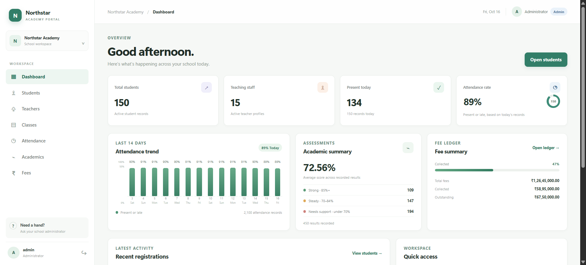
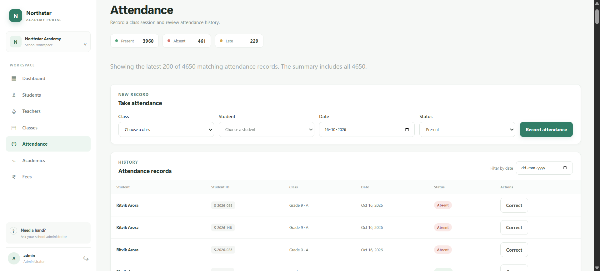
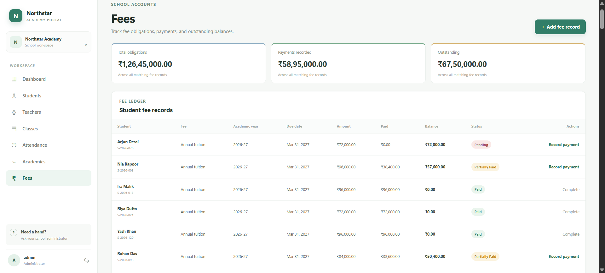

# Student Management System — School Administration Platform

[](https://react.dev/)
[](https://www.typescriptlang.org/)
[](https://vitejs.dev/)
[](https://expressjs.com/)
[](https://www.mongodb.com/)
[](https://mongoosejs.com/)
[](LICENSE)

A full-stack school administration application built for the **CodSoft Full Stack Web Development Internship (Task 1)**. Administrators, teachers and students sign in to manage and view student records, classes, attendance, examination results and fees. Every record is stored in MongoDB, and role checks run on the server.

This is an internship demonstration project. **Fee payments are records only:** no money moves and no payment service is connected.

---

## Features

### Administrator
- School dashboard with student and teacher counts, attendance trends, grade bands and fee totals, calculated with MongoDB aggregation.
- Students: search, class and status filters, server-side sorting, pagination, profile details, edits and safe deactivation. History is kept.
- Teachers: profiles and safe deactivation.
- Classes: create and edit class sections and assign teachers.
- Fees: create fee obligations, record partial payments, see outstanding balances and payment history. Totals include the full ledger, and a fee cannot be overpaid.

### Teacher
- Students in assigned classes only.
- Attendance by student, class and date, with duplicate prevention and status correction. Every correction is recorded and visible.
- Examination schedules and student results, with score validation.

### Student
- Own profile, own class, attendance and results.
- Own fee obligations and payment history.

### Platform
- HttpOnly cookie login and logout with bcrypt password hashing.
- An idempotent development seed, and a read-only import tool for data from the original PostgreSQL version.
- React Testing Library tests, and Supertest API tests against a real, guarded MongoDB test database.

---

## Technology Stack

| Layer | Technology |
|---|---|
| Frontend | React 19, TypeScript, Vite 8, CSS |
| Backend | Node.js, Express 5, TypeScript |
| Database | MongoDB with Mongoose 9 |
| Authentication | Signed JWT in an HttpOnly cookie, bcrypt password hashing (`bcryptjs`), role-based authorization |
| Testing | Vitest, React Testing Library, Supertest |

Verified with Node.js 24 and MongoDB 7.

---

## Architecture Overview

```text
Browser (React SPA, :5173) --/api proxy--> Express REST API (:5017) --Mongoose--> MongoDB
```

- **API:** Express routes check the session, the role and, for teachers, the class assignment before reading or writing data.
- **Data:** collections for users, students, teachers, classes, attendance, exams, results, fees and payments, linked by ObjectId. See [docs/DATABASE_SCHEMA.md](docs/DATABASE_SCHEMA.md).
- **Multi-document writes:** the app works on a standalone MongoDB server without transactions. Writes that span two documents undo the first if the second fails. See [docs/ARCHITECTURE.md](docs/ARCHITECTURE.md#atomic-writes-without-transactions).

```text
Task1-Student-Management/
├── docs/             # architecture, schema, API, testing, learning guide, screenshots
├── public/           # browser icons and static assets
├── server/
│   ├── scripts/      # one-time PostgreSQL-to-MongoDB import
│   ├── src/          # Express app, Mongoose models and API routes
│   └── tests/        # API and MongoDB behaviour tests
└── src/              # React application, pages, components and tests
```

Further reading: [Architecture](docs/ARCHITECTURE.md), [API specification](docs/API_SPECIFICATION.md), [Database schema](docs/DATABASE_SCHEMA.md), [Testing report](docs/TESTING_REPORT.md), [Learning guide](docs/LEARNING_GUIDE.md), [Demo video outline](docs/DEMO_VIDEO_OUTLINE.md).

---

## Setup

### Prerequisites
- Node.js 20.19 or newer, and npm. Node.js 24 is used during development.
- MongoDB 7 or newer. A local standalone server is enough; a replica set is not required. Install [MongoDB Community Server](https://www.mongodb.com/try/download/community) and confirm it is running with `Get-Service MongoDB`.
- Windows PowerShell for the commands below.

### 1. Install dependencies
```powershell
git clone https://github.com/srisnigdha-08/CodSoft-Internship.git
cd CodSoft-Internship/Task1-Student-Management
npm install
npm --prefix .\server install
```

### 2. Configure the environment
```powershell
if (-not (Test-Path .\server\.env)) { Copy-Item .\server\.env.example .\server\.env }
notepad server/.env
```

| Variable | Required | Purpose |
|---|---|---|
| `MONGODB_URI` | Yes | Application database. Must name a database, for example `mongodb://localhost:27017/codsoft_student_management` |
| `JWT_SECRET` | Yes | Random secret of at least 32 characters. There is no fallback value |
| `MONGODB_TEST_URI` | For tests | Must name exactly `codsoft_student_management_test` |
| `PORT` | No | API port, default `5017` |
| `FRONTEND_ORIGIN` | No | Allowed browser origin, default `http://localhost:5173` |
| `NODE_ENV` | No | `production` enables the `Secure` cookie flag and blocks the seed |
| `LEGACY_PG_*` | Only for the import | Read-only access to the old PostgreSQL database |

The API exits with a clear message when a required value is missing, and never logs a URI that contains credentials. `.env` files are git-ignored. Never commit real credentials.

### 3. Seed demo data
```powershell
npm --prefix .\server run db:seed
```

No schema step is needed. MongoDB creates collections on first write, and the API builds the Mongoose indexes when it connects.

The seed is fictional, development-only and safe to repeat. It refuses to run when `NODE_ENV=production` or against any database not named for this project, never deletes anything, and leaves existing records as they are. A clean run produces:

| Collection | Documents |
|---|---:|
| users | 166 |
| students | 150 |
| teachers | 15 |
| classes | 10 |
| attendance | 4650 (31 school days per student) |
| exams | 30 |
| results | 450 |
| fees | 151 |
| payments | 101 |

Attendance covers the 31 school days ending on the day of the first seed. A later run does not extend it.

### 4. Run the app
In two terminals, from the project root:
```powershell
npm --prefix .\server run dev
```
```powershell
npm run dev
```
Open **http://localhost:5173**. Vite forwards `/api` to `http://127.0.0.1:5017`.

The API uses port 5017 because another application on this workstation already uses port 5000. If you change `PORT`, start Vite with a matching `$env:VITE_API_PORT='your-port'`. Check the database connection with `Invoke-RestMethod http://localhost:5017/api/health`; it returns HTTP 200 only when MongoDB answers a ping.

### Demo accounts
Created by the seed for local evaluation only:

| Role | Email | Password |
|---|---|---|
| Administrator | `admin@school.local` | `Admin@12345` |
| Teacher | `teacher@school.local` | `Teacher@12345` |
| Student | `student@school.local` | `Student@12345` |

Other generated accounts follow `teacherNNN@staff.example.test` (password `Teacher@12345`) and `studentNNN@students.example.test` (password `Student@12345`). Names and contact details are synthetic. Never use these shared passwords with real student information.

---

## Workflows

**Administrator:** sign in → review the dashboard → add or edit students and teachers → create classes and assign teachers → create fee obligations and record payments.

**Teacher:** sign in → open an assigned class → mark attendance for the day → correct a status if needed → schedule an examination → enter results.

**Student:** sign in → view own class, attendance and results → check fee balances and payment history.

---

## API Overview

Base path: `/api`. Successful responses use a `data` field. Errors use `{ "error": { "code": "...", "message": "..." } }`. The session is the `sms_session` HttpOnly cookie set by login. Full details are in [docs/API_SPECIFICATION.md](docs/API_SPECIFICATION.md).

| Area | Endpoints | Access |
|---|---|---|
| Health | `GET /health` | Public |
| Auth | `POST /auth/login`, `POST /auth/logout`, `GET /auth/me` | Public, except `/me` |
| Dashboard | `GET /dashboard/stats` | Signed in |
| Students | `GET /students`, `GET /students/:id` | Admin; teachers for assigned classes; a student for their own record |
| Student management | `POST /students`, `PUT /students/:id`, `DELETE /students/:id` | Admin |
| Teachers | `GET /teachers`, `GET /teachers/:id` | Admin; a teacher for their own profile |
| Teacher management | `POST /teachers`, `PUT /teachers/:id`, `DELETE /teachers/:id` | Admin |
| Classes | `GET /classes` | Signed in, scoped by role |
| Class management | `POST /classes`, `PUT /classes/:id` | Admin |
| Attendance | `GET /attendance` | Signed in, scoped by role |
| Attendance recording | `POST /attendance`, `PUT /attendance/:id`, `GET /attendance/:id/corrections` | Admin, assigned teacher |
| Academics | `GET /academics/examinations`, `GET /academics/results` | Signed in, scoped by role |
| Academic management | `POST /academics/examinations`, `POST /academics/results` | Admin, assigned teacher |
| Fees | `GET /fees`, `GET /fees/:id/payments` | Admin, the student concerned |
| Fee management | `POST /fees`, `POST /fees/:id/payments` | Admin |
| Payment history | `GET /payments` | Admin; a student for their own records |

---

## Testing and Building

The backend tests run the real Express routes against MongoDB, only in `codsoft_student_management_test`. Before connecting, the suite confirms that `MONGODB_TEST_URI` names exactly that database. It then writes a guard marker, refuses to touch a non-empty unmarked database, and rechecks the marker before each cleanup. The application database is never used.

```powershell
npm test                                         # frontend tests
npm run typecheck                                # frontend TypeScript checks
npm run lint                                     # frontend lint
npm --prefix .\server test                       # backend tests (requires MongoDB)
npm --prefix .\server run typecheck              # backend TypeScript checks
npm --prefix .\server run typecheck:integration  # integration test TypeScript checks
npm --prefix .\server run lint                   # backend lint
```

To build for production:
```powershell
npm run build                     # frontend, output in dist
npm --prefix .\server run build   # backend, output in server/dist
npm --prefix .\server start
```

Serve the frontend `dist` folder with a static web server that forwards `/api` to the backend. Keep the frontend and API on the same site, because the session cookie is `SameSite=Strict`. See [docs/TESTING_REPORT.md](docs/TESTING_REPORT.md) for the latest results.

---

## Security Notes

- Passwords are hashed with bcryptjs. The hash field is excluded from queries by default and never returned by an endpoint.
- Session tokens are signed, stored in an `HttpOnly`, `SameSite=Strict` cookie (`Secure` in production), and expire after eight hours. Nothing is kept in browser storage.
- `JWT_SECRET` has no fallback value.
- Each authenticated request checks that the user and their linked student or teacher profile are still active.
- Role checks and class assignment checks run on the server, so records stay protected even if the UI is changed.
- IDs must be 24-character hex strings and other inputs must have the expected type, so request bodies cannot inject MongoDB query operators. Search text is escaped and matched literally.
- Unique indexes back up API validation. Fee payments use an atomic, guarded update so a fee cannot be overpaid.
- CORS is limited to `FRONTEND_ORIGIN`, and unsafe requests from a different `Origin` are rejected.

### Writes without transactions
The app is designed for a standalone MongoDB server, which has no multi-document transactions. Writes that span two documents, such as an account and its profile, undo the first write if the second fails. This covers application errors, but a process crash between the two steps could leave a partial write. See [docs/ARCHITECTURE.md](docs/ARCHITECTURE.md#atomic-writes-without-transactions).

---

## Migrating Existing PostgreSQL Data

The application no longer uses PostgreSQL. The import tool exists only to copy data from an older installation. It needs the `psql` client on `PATH` and the `LEGACY_PG_*` values in `server/.env`.

```powershell
npm --prefix .\server run db:migrate:postgres             # reads, transforms and validates; writes nothing
npm --prefix .\server run db:migrate:postgres -- --apply  # imports, then verifies counts, references and money totals
```

The tool reads PostgreSQL inside a single `READ ONLY` snapshot, and stops if the server does not confirm that mode. It refuses a target that already holds documents from another source. Each legacy row maps to a fixed ObjectId, so running it again changes nothing. Older session cookies carry numeric IDs and are rejected, so users must sign in again. See [docs/DATABASE_SCHEMA.md](docs/DATABASE_SCHEMA.md#migrating-from-postgresql).

---

## Troubleshooting

- **API exits at startup:** check that `server/.env` exists and sets `MONGODB_URI` and a `JWT_SECRET` of at least 32 characters.
- **"MongoDB could not be reached":** run `Get-Service MongoDB` and start the service if needed. Confirm the host and port in `MONGODB_URI`.
- **"must be a mongodb:// URI that names a database":** add the database name to the end of the URI.
- **Seed refused:** the seed only runs against a database named `codsoft_student_management` or starting with `codsoft_student_management_`, and never with `NODE_ENV=production`.
- **Tests refused:** set `MONGODB_TEST_URI` to `mongodb://localhost:27017/codsoft_student_management_test`. If that database holds unrelated data, review and empty it yourself.
- **Port already in use:** leave the owning application running. Choose a free API port, update `PORT` in `server/.env`, and use the same value for `$env:VITE_API_PORT` before starting Vite.

---

## Limitations

1. **The seed is for demonstration only** and is blocked when `NODE_ENV=production`.
2. **No password reset or password-change screen.** Administrators set initial passwords for new accounts.
3. **Examination and result history is append-only** in the UI. Correction workflows are not included.
4. **Attendance corrections** record the status, actor and time, but do not require a reason or offer an exportable audit report.
5. **Long lists are capped.** Attendance history shows the latest 200 matching rows and fee history the latest 300, while their summaries count every matching row. Larger deployments need pagination or server-side search in both modules.
6. **Management forms load the whole active student roster.** A large school would need a searchable student selector.
7. **No transactions.** A crash between the two steps of a two-document write could leave a partial write. See Writes without transactions above.
8. **Fee records are administrative only.** There is no payment gateway, invoicing, refunds, tax handling or accounting export.
9. **Port 5017 instead of 5000**, because another local application owns port 5000. Do not stop that process.

---

## Screenshots

Captured from the running application with fictional demonstration records. [docs/screenshots/README.md](docs/screenshots/README.md) lists all eight.

| Administrator Dashboard | Attendance | Fee Management |
|---|---|---|
|  |  |  |

Also available: [Login](docs/screenshots/login.png), [Students](docs/screenshots/students.png), [Teachers](docs/screenshots/teachers.png), [Classes](docs/screenshots/classes.png), [Academic results](docs/screenshots/academics.png).

---

## License

This project is licensed under the MIT License. See the [LICENSE](LICENSE) file.
