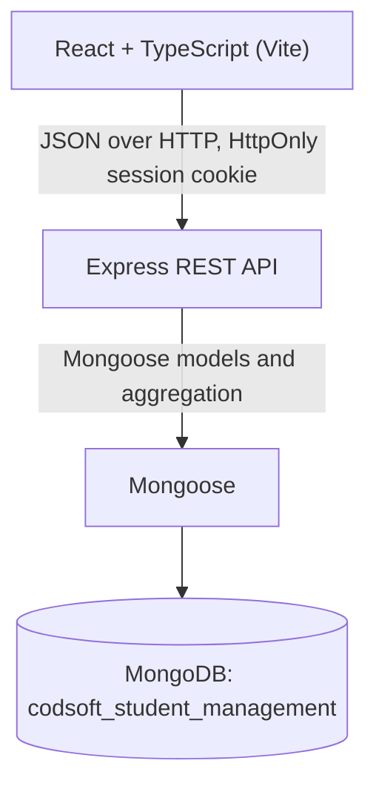

# Architecture

## Layers

The browser never talks to MongoDB. Only the API holds the connection string.

| Layer | Location | Responsibility |
| --- | --- | --- |
| Web client | `src/` | Pages, forms, role-aware navigation |
| HTTP API | `server/src/app.ts`, `server/src/routes/` | CORS, origin check, input validation, responses |
| Authorization | `server/src/auth.ts` | JWT cookie, active-account check, role and class scope |
| Data model | `server/src/models/index.ts` | Schemas, validation, indexes |
| Connection | `server/src/db.ts`, `server/src/env.ts` | Connect, build indexes, health ping, configuration |

## Request flow

1. React calls `/api/...` with `credentials: 'include'`, so the browser sends the `sms_session` cookie.
2. `requireAuth` verifies the JWT, then loads the account and its profile from MongoDB. A deactivated account or changed role is rejected immediately, even with an unexpired cookie.
3. `requireRole` and the route's own scope checks decide what the caller may touch. Teacher access is limited to the classes where `classes.teacherId` is their profile, and student access to their own `studentId`.
4. Validators in `errors.ts` check each value's type and shape. IDs must be 24-character hex strings.
5. Mongoose runs the query. Lists use `aggregate()` with `$lookup`, or `find()` with `populate()`, and always limit their output.
6. A presenter converts the document to the API's JSON shape: string IDs, `YYYY-MM-DD` dates, and decimal money.
7. The central error handler maps duplicates to 409 and validation failures to 400. It never returns driver details.

## Connection and startup

`index.ts` validates configuration, connects, builds all indexes, and only then starts listening. A missing `MONGODB_URI`, an unreachable server, or an index that cannot be built stops startup with a clear message.

`bufferCommands` is off, so requests fail quickly while MongoDB is down instead of queueing. `GET /api/health` runs a real `ping` and returns 503 when it fails.

## Atomic writes without transactions

MongoDB multi-document transactions require a replica set, and this project runs on a standalone local server. The design therefore puts each invariant in a single document, where MongoDB's updates are atomic.

| Operation | Technique | Guarantee |
| --- | --- | --- |
| Attendance correction | One `updateOne` that matches the previous status, sets the new one, and `$push`es the audit entry | Status and audit entry always change together; a concurrent correction gets 409 |
| Fee payment | `findOneAndUpdate` that increments `paidCents` only when `paidCents + amount <= amountCents` | Concurrent payments cannot overpay a fee |
| Duplicate attendance, results, references | Unique indexes | Enforced by MongoDB, including under concurrent requests |

Two operations still span two documents, and they use compensation:

- **Creating a student or teacher** writes the user and then the profile. If the profile fails, the user is deleted.
- **Recording a payment** reserves the amount on the fee and then inserts the payment. If the insert fails, the reservation is reversed.
- **Editing a student or teacher** updates the user and then the profile, restoring the user's previous values if the profile fails.

A process crash between those two steps could leave a partial write. For payments, this fails safe: the fee would show too much paid, which blocks further payments rather than allowing overpayment. If this application moves to a replica set, these three flows can use a Mongoose session instead.

## Security boundaries

- The JWT stays in an HttpOnly, `SameSite=Strict` cookie; browser storage is not used.
- `JWT_SECRET` must be set and at least 32 characters long; there is no fallback.
- `passwordHash` is `select: false`, and aggregation joins project only named fields, so it cannot reach a response by accident.
- Requests with a foreign `Origin` are refused for unsafe methods, in addition to CORS.
- Filters are built from validated scalars, never from raw request objects, and `strictQuery` is on.

## Database isolation

| Purpose | Database | Protection |
| --- | --- | --- |
| Application | `codsoft_student_management` | Set in `MONGODB_URI` |
| Tests | `codsoft_student_management_test` | Exact name check before connecting, plus a guard marker before each cleanup |
| Seed and import | Project databases only | Refused for any database not named for this project |

## Data import

`server/scripts/` holds the one-time PostgreSQL import. It is not part of the compiled application and uses the `psql` CLI, so the running API has no PostgreSQL code or dependency. See [DATABASE_SCHEMA.md](DATABASE_SCHEMA.md#migrating-from-postgresql).
