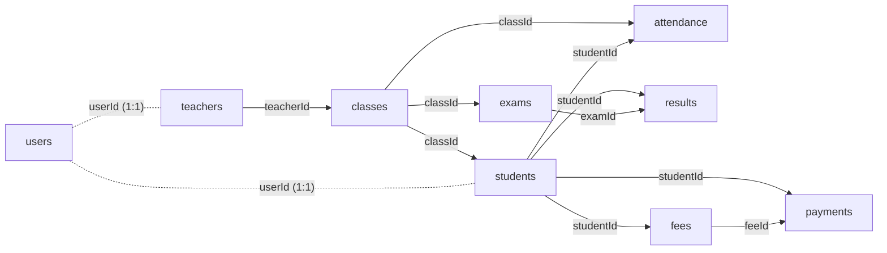

# MongoDB Database Schema

Application database: `codsoft_student_management`. Test database: `codsoft_student_management_test`. All schemas are defined in `server/src/models/index.ts`.

## Design

### What is embedded and what is referenced

| Data | Choice | Reason |
| --- | --- | --- |
| Attendance corrections | **Embedded** in `attendance.corrections` | Only ever read with their record, small in number, and written atomically with the status change |
| Student ↔ user, teacher ↔ user | Referenced, one-to-one | Accounts have different read patterns and hold the password hash, which should stay out of profile reads |
| Class on a student, teacher on a class | Referenced | A class is shared by many students; a teacher can be reassigned with one write |
| Attendance | Separate collection | Grows every school day (thousands of rows) and is queried across students and classes |
| Exams and results | Separate collections | Results grow per student and are paginated across exams |
| Fees and payments | Separate collections, with a running total on the fee | Payments are an unbounded ledger with a globally unique reference; `paidCents` makes balances cheap and overpayment guardable |

### Conventions

- Every document has an `ObjectId` `_id`, and the API exposes it as a 24-character string.
- Every collection has `createdAt` and `updatedAt`.
- **Calendar days** (`date`, `dueDate`, `dateOfBirth`) are stored at UTC midnight and sent as `YYYY-MM-DD`, so a day cannot shift between timezones.
- **Money** is stored in integer cents (`amountCents`, `paidCents`) and sent as decimals, so totals are exact.
- **Roles and statuses** are lowercase, matching the existing API contract.

## Collections

### users

| Field | Type | Rules |
| --- | --- | --- |
| `name` | String | Required, up to 161 characters; follows the linked profile |
| `email` | String | Required, unique, lowercased, email format |
| `passwordHash` | String | Required, bcrypt, `select: false` |
| `role` | String | `admin`, `teacher`, `student` |
| `status` | String | `active` or `inactive` |

### students

| Field | Type | Rules |
| --- | --- | --- |
| `userId` | ObjectId → users | Required, unique |
| `firstName`, `lastName` | String | Required, up to 80 |
| `studentNumber` | String | Required, unique, up to 40 |
| `classId` | ObjectId → classes | Optional |
| `dateOfBirth` | Date | Optional, calendar day |
| `phone` | String | Optional, up to 32 |
| `address` | String | Optional, up to 255 |
| `status` | String | `active` or `inactive` |

### teachers

| Field | Type | Rules |
| --- | --- | --- |
| `userId` | ObjectId → users | Required, unique |
| `firstName`, `lastName` | String | Required, up to 80 |
| `employeeNumber` | String | Required, unique, up to 40 |
| `subject` | String | Required, up to 120 |
| `status` | String | `active` or `inactive` |

A teacher's assigned classes are derived from `classes.teacherId`, so there is one source of truth.

### classes

| Field | Type | Rules |
| --- | --- | --- |
| `name` | String | Required, up to 80 |
| `section` | String | Required, default `A`, up to 40 |
| `teacherId` | ObjectId → teachers | Optional |

### attendance

| Field | Type | Rules |
| --- | --- | --- |
| `studentId` | ObjectId → students | Required |
| `classId` | ObjectId → classes | Required |
| `date` | Date | Required, calendar day |
| `status` | String | `present`, `absent`, `late` |
| `recordedBy` | ObjectId → users | Required |
| `corrections[]` | Embedded | `{ _id, previousStatus, newStatus, correctedBy → users, correctedAt }` |

### exams

| Field | Type | Rules |
| --- | --- | --- |
| `title` | String | Required, up to 120; includes the subject, such as `Term 1 Science` |
| `classId` | ObjectId → classes | Required |
| `date` | Date | Required, calendar day |
| `maxScore` | Number | 0.01 to 99999.99 |
| `createdBy` | ObjectId → users | Required |

### results

| Field | Type | Rules |
| --- | --- | --- |
| `studentId` | ObjectId → students | Required |
| `examId` | ObjectId → exams | Required |
| `score` | Number | Zero or more; the API also rejects a score above the exam's maximum |
| `recordedBy` | ObjectId → users | Required |

Grades are not stored. Percentages and grade bands are calculated when read.

### fees

| Field | Type | Rules |
| --- | --- | --- |
| `studentId` | ObjectId → students | Required |
| `description` | String | Required, up to 120 |
| `academicYear` | String | Required, up to 16 |
| `amountCents` | Number | Whole number, at least 1 |
| `paidCents` | Number | Whole number, at least 0; running total of this fee's payments |
| `dueDate` | Date | Required, calendar day |
| `createdBy` | ObjectId → users | Required |

Status is derived from the two amounts: `pending` when nothing is paid, `partially paid`, or `paid`.

### payments

| Field | Type | Rules |
| --- | --- | --- |
| `feeId` | ObjectId → fees | Required |
| `studentId` | ObjectId → students | Required; copied from the fee for student-scoped queries |
| `amountCents` | Number | Whole number, at least 1 |
| `paidAt` | Date | Required |
| `referenceCode` | String | Required, unique, up to 80 |
| `recordedBy` | ObjectId → users | Required |

## Indexes

Each index serves a real query. The API builds them at startup.

| Collection | Index | Unique | Used by |
| --- | --- | :---: | --- |
| users | `email` | Yes | Login, uniqueness |
| students | `userId` | Yes | Session profile lookup |
| students | `studentNumber` | Yes | Uniqueness, sort |
| students | `classId, status` | | Class rosters, teacher scope, dashboard |
| students | `status, createdAt` | | Default newest-first list, recent registrations |
| teachers | `userId` | Yes | Session profile lookup |
| teachers | `employeeNumber` | Yes | Uniqueness |
| teachers | `status, lastName, firstName` | | Sorted directory |
| classes | `name, section` | Yes | Uniqueness, sorted list |
| classes | `teacherId` | | Teacher scope, used on most teacher requests |
| attendance | `studentId, classId, date` | Yes | One record per student, class, and day |
| attendance | `studentId, date` | | Student history |
| attendance | `classId, date` | | Teacher views and class filters |
| attendance | `date, classId` | | Date filter, dashboard today and trend |
| exams | `title, classId, date` | Yes | Uniqueness |
| exams | `classId, date` | | Class schedules, teacher scope |
| results | `studentId, examId` | Yes | One result per exam; student results |
| results | `examId` | | Teacher scope |
| fees | `studentId, description, academicYear` | Yes | One obligation per year; student ledger |
| fees | `dueDate, _id` | | Ledger sort |
| payments | `referenceCode` | Yes | Uniqueness |
| payments | `feeId, paidAt` | | Payment history for a fee |
| payments | `studentId, paidAt` | | `GET /api/payments` |

## Validation

Validation happens in three places:

1. **API validators** check types, formats, lengths, and business rules, and return specific 400 messages.
2. **Mongoose schemas** enforce required fields, enums, lengths, and integer cents, as a second layer.
3. **Unique indexes** are the final guard against duplicates, including under concurrent requests.

MongoDB has no foreign keys, so routes confirm that referenced records exist before writing. Students and teachers are deactivated rather than deleted, and classes, exams, and fees have no delete endpoint, so references remain valid.

## Not in this schema

The PostgreSQL version had no class academic year, no subject column on exams, and no stored grade, so none were invented. `academicYear` lives on fees, the subject is part of the exam title, and grade bands are calculated.

Sorting by name uses MongoDB's default binary order, which sorts capital letters before lowercase ones. Names in the demo data all start with a capital.

## Migrating from PostgreSQL

`server/scripts/migrate-postgres-to-mongo.ts` runs in these steps:

1. **Read.** `psql` runs one `READ ONLY`, repeatable-read snapshot. The script stops if the server does not confirm read-only mode.
2. **Transform** (`legacyTransform.ts`). See the mapping below.
3. **Validate.** Every document must pass its Mongoose schema. Without `--apply`, the tool stops here.
4. **Check the target.** It refuses a collection holding documents from another source.
5. **Insert.** Insert-only upserts, so documents already imported are kept as they are.
6. **Verify.** Compares counts, embedded corrections, 13 reference fields, and money totals against the snapshot, and exits with an error on any difference.

| PostgreSQL | MongoDB |
| --- | --- |
| `BIGSERIAL id` | `ObjectId` from a hash of the table name and ID, so reruns map to the same document |
| Foreign key columns | `ObjectId` references using the same mapping |
| `examinations`, `academic_results`, `fee_records`, `fee_payments` | `exams`, `results`, `fees`, `payments` |
| `attendance_corrections` rows | Embedded in `attendance.corrections` |
| `NUMERIC` money | Integer cents |
| `SUM(fee_payments.amount)` | `fees.paidCents` |
| `DATE` | UTC-midnight `Date` |
| Profile name and status | `users.name` and `users.status` (administrators default to active) |

Bcrypt hashes are copied unchanged, so existing passwords keep working. The outcome of the import on this project is recorded in [TESTING_REPORT.md](TESTING_REPORT.md#data-migration).
