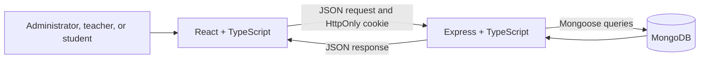

# Learning Guide — Student Management System

This guide describes the implementation in beginner-friendly steps. Read it alongside the source files and the [project README](../README.md).

## 1. Overall architecture

The project has three parts:

1. **React in the browser** displays pages and forms.
2. **Express API** checks each request, permissions, and input, then uses Mongoose to read and write data.
3. **MongoDB** stores users, student and teacher profiles, attendance, exams, results, and fees.

React never connects to MongoDB directly. Only the backend has the connection string.



## 2. What each technology does

- **React** builds the screen from reusable components. Changing state, such as the selected page or a loaded list, updates the screen.
- **TypeScript** checks data shapes while developing. For example, `Student` describes the fields a student page expects.
- **Vite** runs the local development server and bundles the browser application for production. Its local proxy sends `/api` calls to Express.
- **Node.js** runs the JavaScript server outside the browser.
- **Express** maps HTTP methods and URL paths to API handlers and middleware.
- **MongoDB** stores data as documents grouped in collections, and enforces rules such as unique email addresses and one attendance entry per student, class, and date through unique indexes.
- **Mongoose** defines the shape of each document, validates it, and provides query methods such as `find`, `create`, and `aggregate`.

## 3. A request from the browser to the database

When an administrator creates a student:

1. A React form collects a name, email, student number, class, contact details, and initial password.
2. The form checks required values and sends a JSON `POST /api/students` request.
3. The browser sends its HttpOnly session cookie automatically because the API helper uses `credentials: 'include'`.
4. Express verifies the cookie and checks the administrator role against the current user document.
5. The route validates each value and hashes the password with bcryptjs.
6. The API creates the `users` document and then the `students` document. If the second write fails, the API deletes the first, so no orphaned account remains.
7. MongoDB's unique indexes reject a duplicate email or student number.
8. Express returns the new profile without the password hash. React closes the form and reloads the list.

## 4. Folder structure

```text
src/
  api.ts                   Shared JSON request helper and API errors
  App.tsx, navigation.ts   Login state and URL hash section navigation
  App.css, index.css       Application styling and responsive layout
  components/
    LoginForm.tsx          Sign-in form and validation
    shared.tsx             Reusable fields, buttons, messages, and modal
  pages/                   Dashboard and each management module
  types.ts                 Shared browser-side TypeScript types
  utils/format.ts          Date, currency, and initials display helpers
  test/                    Vitest setup and React Testing Library config
server/
  scripts/                 One-time import from the old PostgreSQL database
  src/
    app.ts                 Express application and shared middleware
    auth.ts                Session cookie and current-account authorization
    db.ts                  MongoDB connection, indexes, and health ping
    models/index.ts        Mongoose schemas, validation, and indexes
    queryStages.ts         Reusable aggregation join stages
    dates.ts               Calendar-day conversion helpers
    databaseGuards.ts      Seed protection and safe error messages
    errors.ts              Validation helpers and safe API errors
    index.ts               Server startup and shutdown
    seed.ts                Idempotent demo data
    routes/                Authentication and domain API routes
  tests/                   API and MongoDB behavior tests
docs/                      This guide, architecture, schema, API, testing
```

The backend entry point is `server/src/index.ts`.

## 5. Collections and relationships

MongoDB stores **documents** (similar to JSON objects) in **collections**. Documents link to each other through an **ObjectId** reference.

- **users** stores a name, unique email, password hash, role (`admin`, `teacher`, or `student`), and status.
- **students** stores a student number, name, class, date of birth, phone, optional address, and status. `userId` links it to the sign-in account.
- **teachers** stores an employee number, name, subject, and status. `userId` links it to the teacher account.
- **classes** stores a class name and section. An optional `teacherId` points to a teacher profile.
- **attendance** links a student, class, date, and status. A unique index prevents duplicates for the same student, class, and date. Corrections are **embedded** inside this document.
- **exams** belongs to a class and stores its date and maximum score.
- **results** links a student to an exam and stores a score. The route checks the score against the exam maximum.
- **fees** stores the amount owed, the running amount paid, and the due date for one student and academic year.
- **payments** stores each payment record.

MongoDB has no foreign keys, so a route confirms that a referenced record exists before writing. Student and teacher removal is a status change, not a delete, so history keeps its references. Full details are in [DATABASE_SCHEMA.md](DATABASE_SCHEMA.md).

### Embedding or referencing?

Embed data when it belongs to one parent, stays small, and is read together with it. Attendance corrections fit this. Reference data when it is shared, grows without limit, or is queried on its own. Attendance records and payments fit this.

## 6. Authentication and role checks

During login, the backend finds the normalized email, compares the submitted password with the stored bcrypt hash, and signs a short-lived JWT. The token goes into an `HttpOnly`, `SameSite=Strict` cookie. JavaScript cannot read that cookie.

For each protected request, the backend verifies the token and rechecks that the user and linked profile remain active in MongoDB. This means a deactivated account loses access before the cookie expires. The browser sends the cookie through `credentials: 'include'`.

Role checks happen on the backend:

- Administrators can manage all profiles, classes, fee obligations, and payment records.
- Teachers can read students in their assigned classes and manage attendance, examinations, and results for those classes.
- Students can read their own profile, attendance, results, and fee records.

The frontend hides controls that a role does not need, but hidden controls are not the security boundary. The API checks the role and, for teachers, class assignment again. Student payment-history requests are scoped to the student's own fee records before the API checks whether a record exists, so another record ID cannot be probed.

## 7. CRUD endpoints

Student endpoints use:

- `GET /api/students?page=1&limit=10&search=maya&status=active&classId=...&sortBy=name&sortOrder=asc` to search, filter, sort, and paginate. Sort fields are selected from a server-side allowlist.
- `POST /api/students` to create a student account and profile together.
- `GET /api/students/:id` to read a profile if the user is allowed to see it.
- `PUT /api/students/:id` to update the email and student details.
- `DELETE /api/students/:id` to set the profile inactive and preserve its history.

A duplicate email or student number produces HTTP 409. An invalid value produces HTTP 400. A missing profile produces HTTP 404. The response never includes the password hash.

Teacher management follows the same account-plus-profile approach. Classes can be created and assigned to active teachers. Attendance, academics, and fees use their own route modules so each area's rules stay readable.

Calendar days are stored at UTC midnight and sent as `YYYY-MM-DD`, because a JavaScript `Date` can otherwise shift a day when a timezone is applied. Money is stored in integer cents, because adding decimals such as 0.1 and 0.2 in binary floating point does not give exactly 0.3.

Attendance returns the latest 200 matching rows and a `meta.summary` calculated over every matching row. Academic results use `?page=N` with 50 rows per page. Fees return the latest 300 records while `meta.summary` covers the full matching ledger.

## 8. Environment variables

If it does not exist, copy `server/.env.example` to `server/.env`. `server/src/env.ts` uses a path relative to its own source file, so the backend finds the same `.env` when scripts run from the project root, `server/`, or compiled `server/dist/`. It validates `MONGODB_URI`, the API port, and a 32-character `JWT_SECRET` without printing secret values.

The Vite client does not receive the connection string or JWT secret. `.gitignore` excludes environment files other than the example template.

## 9. Error handling

Validation helpers in `server/src/errors.ts` throw an `ApiError` with an HTTP status, message, and machine-readable code. Express 5 forwards rejected async route handlers to the central handler in `app.ts`.

The handler translates MongoDB's duplicate key error (code 11000) into HTTP 409 and Mongoose validation errors into HTTP 400. Unexpected errors return a generic HTTP 500 response. It does not send stack traces, queries, or connection details to the browser.

## 10. Run and debug in Windows PowerShell

1. Start the MongoDB Windows service.
2. Confirm `server/.env` has `MONGODB_URI` and a long `JWT_SECRET`.
3. In one PowerShell terminal at the project root, run `npm --prefix .\server run db:seed`, then start the API with `npm --prefix .\server run dev`.
4. In a second terminal at the project root, run `npm run dev`.
5. Open `http://localhost:5173` and use one of the demo accounts from the README.
6. Open `http://localhost:5017/api/health`. HTTP 200 means Express reached MongoDB; HTTP 503 means the check failed.
7. If a page is empty, open browser developer tools, inspect the Network response, then inspect the matching Express route and query.

Useful commands:

```powershell
Get-Service MongoDB
Test-NetConnection localhost -Port 27017
Invoke-RestMethod http://localhost:5017/api/health
mongosh mongodb://localhost:27017/codsoft_student_management --eval "db.students.countDocuments()"
```

Do not paste real passwords into issue reports or logs. The application uses soft deactivation so student and teacher history remains available.

## 11. Important code files

- `src/App.tsx`: restores the signed-in user and renders navigation based on role.
- `src/api.ts`: adds JSON headers, includes the session cookie, and turns API errors into readable messages.
- `src/components/LoginForm.tsx`: validates login input and handles server errors.
- `src/pages/StudentsPage.tsx`: student search, pagination, create/edit forms, details, and safe deactivation.
- `server/src/app.ts`: CORS, health, route mounting, not-found responses, and centralized errors.
- `server/src/auth.ts`: cookie reading, JWT verification, and database-backed active-account checks.
- `server/src/db.ts`: connects to MongoDB, builds indexes, and performs the health ping.
- `server/src/models/index.ts`: every schema, its validation, and its indexes.
- `server/src/routes/students.ts`: student validation, aggregation-based listing, and account-plus-profile writes.
- `server/src/routes/attendance.ts`: duplicate protection and the atomic correction update.
- `server/src/routes/fees.ts`: the guarded payment update that prevents overpayment.
- `server/src/routes/dashboard.ts`: role-scoped attendance, academic, and fee aggregation.
- `server/src/env.ts`: resolves and validates backend configuration independently of the current working directory.
- `server/src/seed.ts`: inserts fictional, conflict-safe demonstration data; it never replaces an existing password or profile.
- `server/scripts/migrate-postgres-to-mongo.ts`: reads the old database in read-only mode, imports, and verifies.

## 12. Common bugs and debugging steps

| Symptom | Likely cause | Check |
| --- | --- | --- |
| API exits before starting | Missing `.env` values or short JWT secret | Check variable names in `server/.env`; do not print values into a report |
| Health returns 503 | MongoDB stopped or wrong URI | Run `Get-Service MongoDB` and `Test-NetConnection localhost -Port 27017` |
| Login returns 401 | Wrong email/password, seed was not run, or account is inactive | Run `npm --prefix .\server run db:seed`; confirm the account without exposing its hash |
| Login appears to work but the next API call is 401 | Cookie was not sent, or the linked profile is inactive | Check browser Network cookies and the profile status |
| Browser reports a CORS error | `FRONTEND_ORIGIN` differs from the browser origin | Use `http://localhost:5173` consistently or configure the exact origin |
| Duplicate record responds with 409 | Email, student ID, employee ID, attendance combination, or payment reference is already used | Change the unique value or review the existing record |
| "is not a valid record ID" | An ID is not 24 hexadecimal characters | Check the value the client sent |
| New student has no class | The class dropdown was left unassigned | Create a class as administrator and edit the student profile |
| TypeScript reports a stale build | Output folders or config changed | Run `npm run typecheck` from the project and server directories |

## 13. Viva and interview questions

1. **What does the frontend do?** It collects user actions, calls the API, and displays returned records.
2. **Why use an API instead of connecting React to MongoDB?** The connection string stays on the server, where permissions can be enforced.
3. **What is REST?** A common way to model resources with HTTP methods such as GET, POST, PUT, and DELETE.
4. **What does Express do?** It routes HTTP requests to handlers and middleware.
5. **What does TypeScript add?** It checks expected data shapes and many programming mistakes before runtime.
6. **What does Vite do?** It serves the frontend during development and creates its production bundle.
7. **What is a document?** A JSON-like record stored in a MongoDB collection.
8. **What is an ObjectId?** A 12-byte unique identifier MongoDB uses for `_id`. It also serves as a reference to another document.
9. **What does Mongoose add?** Schemas, validation, and convenient queries on top of the MongoDB driver.
10. **Why is email unique?** It identifies one login account and prevents duplicate accounts.
11. **Why hash passwords?** A hash lets the server verify a password without storing the original text.
12. **Can bcrypt hashes be decrypted?** No; login checks a submitted password against the hash.
13. **Why use an HttpOnly cookie?** Browser JavaScript cannot read it, which reduces token theft through some script attacks.
14. **What does role-based authorization mean?** The API grants actions based on a user's role and record relationships.
15. **Why check permissions in the backend?** A user can modify browser code or send requests without using the UI.
16. **What is a NoSQL injection?** Sending a query operator such as `{"$gt": ""}` where a plain value is expected. This API requires strings and valid IDs, so operators are rejected.
17. **Embed or reference?** Embed small data always read with its parent; reference shared or unbounded data.
18. **Why are attendance corrections embedded?** The status and its audit entry can change in one atomic update.
19. **Why are students deactivated instead of deleted?** Attendance, results, and fee history still need their student reference.
20. **How is duplicate attendance prevented?** A unique compound index covers student, class, and date.
21. **How is a fee balance calculated?** The amount owed minus the running paid total, both in cents.
22. **How does the app prevent overpayment?** One atomic update adds the payment only if the new total stays within the amount owed.
23. **Why store money in cents?** Integer arithmetic is exact; binary fractions are not.
24. **What is the aggregation pipeline?** A series of stages such as `$match`, `$lookup`, and `$group` that MongoDB runs to filter, join, and summarize data.
25. **What does `$lookup` do?** It joins matching documents from another collection.
26. **What does HTTP 400 mean?** The request data is invalid or incomplete.
27. **What does HTTP 401 mean?** The request has no valid signed-in session.
28. **What does HTTP 403 mean?** The user is signed in but cannot perform that action or access that record.
29. **What does HTTP 404 mean?** The requested resource does not exist or is intentionally hidden from that user.
30. **Why add indexes?** They speed up common lookups, and unique indexes enforce rules.
31. **Why is the seed script idempotent?** Running it more than once should not create duplicate demo accounts and records.
32. **How do frontend tests differ from API tests?** Frontend tests check UI behavior; API tests exercise HTTP routes, validation, and authorization.
33. **Why use a separate test database?** Tests can create and delete data freely without touching real records.
34. **What is CORS?** A browser rule that controls which website origins can call an API.
35. **What is a limitation of this fee module?** It records administrative payments but does not process real transactions.

## 14. Student creation walkthrough

1. Sign in with an administrator account.
2. Open **Students** and choose **Add student**.
3. Enter the student's name, school email, unique student number, and an initial password. Optionally choose a class and add phone, address, and date of birth.
4. The browser sends `POST /api/students` with JSON. The password travels over the local development connection and is immediately hashed by the API; only the hash is stored.
5. The API checks that the caller is an administrator, normalizes and validates the email, checks the password length, and confirms the class exists.
6. The API inserts a `users` document with the `student` role, then inserts the linked `students` document.
7. A duplicate email or student number returns HTTP 409, and any account already created is removed.
8. The response contains profile fields but never the password hash.
9. The page reloads its database-backed student list. The student can sign in and access only that linked profile and permitted personal records.

For a real deployment, deliver the initial password through a secure school process and replace the current demo account passwords.

## 15. Limitations and future improvements

Current limitations are listed in the README. Reasonable next steps include a password reset flow, class roster pagination, a reason field and export for attendance corrections, attendance summary reports, CSV export, and stronger session revocation. A payment provider should only be added if the school needs real transactions and has an approved payment process.

## 16. How the backend tests stay safe

`npm --prefix .\server test` runs the real Express routes against the dedicated `codsoft_student_management_test` database. Before connecting, the setup checks that the configured name is exactly that one. It then writes a guard marker, refuses to clean a database that has data but no marker, and rechecks the marker before each cleanup. The tests create only fictional accounts and records, and confirm that no documents remain at the end.
