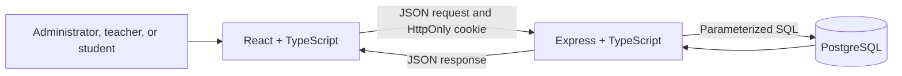

# Learning Guide — Student Management System

This guide describes the implementation in beginner-friendly steps. Read it alongside the source files and the [project README](../README.md).

## 1. Overall architecture

The project has three parts:

1. **React in the browser** displays pages and forms.
2. **Express API** checks each request, permissions, and input, then runs SQL.
3. **PostgreSQL** stores users, student and teacher profiles, attendance, exams, results, and fees.

React never connects to PostgreSQL directly. Only the backend has database credentials.



## 2. What each technology does

- **React** builds the screen from reusable components. Changing state, such as the selected page or a loaded list, updates the screen.
- **TypeScript** checks data shapes while developing. For example, `Student` describes the fields a student page expects.
- **Vite** runs the local development server and bundles the browser application for production. Its local proxy sends `/api` calls to Express.
- **Node.js** runs the JavaScript server outside the browser.
- **Express** maps HTTP methods and URL paths to API handlers and middleware.
- **PostgreSQL** stores durable records and enforces constraints such as unique email addresses and one attendance entry per student, class, and date.
- **`pg`** is the Node PostgreSQL driver. The backend sends SQL with `$1`, `$2`, and so on, then passes values separately.

## 3. A request from the browser to the database

When an administrator creates a student:

1. A React form collects a name, email, student number, class, contact details, and initial password.
2. The form checks required values and sends a JSON `POST /api/students` request.
3. The browser sends its HttpOnly session cookie automatically because the API helper uses `credentials: 'include'`.
4. Express verifies the cookie and checks the administrator role against the current user record.
5. The route validates each value and hashes the password with bcryptjs.
6. A database transaction inserts the account and student profile. If either insert fails, the transaction rolls back.
7. PostgreSQL checks unique IDs, foreign keys, and required values.
8. Express returns the new profile without the password hash. React closes the form and reloads the list.

## 4. Folder structure

```text
src/
  api.ts                   Shared JSON request helper and API errors
  App.tsx, navigation.ts   Login state and URL hash section navigation
  App.css, index.css       Application styling and responsive layout
  components/
    LoginForm.tsx          Sign-in form and validation
    shared.tsx             Reusable fields, buttons, messages, and modal
  pages/                   Dashboard and each management module
  types.ts                 Shared browser-side TypeScript types
  utils/format.ts          Date, currency, and initials display helpers
  test/                    Vitest setup and React Testing Library config
server/
  migrations/              Versioned SQL migrations
  src/
    app.ts                 Express application and shared middleware
    auth.ts                Session cookie and current-account authorization
    db.ts                  PostgreSQL connection pool
    database.ts            Transaction helper
    errors.ts              Validation helpers and safe API errors
    index.ts               Server startup and shutdown
    migrate.ts, seed.ts    Database setup commands
    routes/                Authentication and domain API routes
  tests/api.test.ts        Supertest API tests with a fake database
docs/
  LEARNING_GUIDE.md        This guide
  DEMO_VIDEO_OUTLINE.md    Short presentation outline
```

The backend entry point is `server/src/index.ts`. An obsolete nested starter entry point was removed because it was excluded from the build and used the unrelated port 5000.

## 5. Database tables and relationships

- **users** stores a unique email, a password hash, and one role (`admin`, `teacher`, or `student`).
- **students** stores a student number, name, class, date of birth, phone, optional address, and active/inactive status. `user_id` links it to the sign-in account.
- **teachers** stores an employee number, name, subject, and active/inactive status. `user_id` links it to the teacher account.
- **classes** stores a class name and section. An optional teacher assignment points to a teacher profile.
- **attendance** links a student, class, date, and status. A unique constraint prevents duplicates for the same student, class, and date.
- **attendance_corrections** records the old and new status, correcting user, and time for each status change. The API writes the status and audit row in one transaction.
- **examinations** belongs to a class and stores its date and maximum score.
- **academic_results** links a student to an examination and stores a score. The route checks the score against the examination maximum.
- **fee_records** stores the amount owed and due date for one student and academic year.
- **fee_payments** stores each payment record. The remaining balance is calculated from the obligation amount minus its payments.
- **schema_migrations** records which SQL files have already been applied.

The full ER diagram is in the README. Foreign keys prevent deleting profiles that are still needed by history. Student and teacher removal is therefore a status change, not a physical delete.

## 6. Authentication and role checks

During login, the backend finds the normalized email, compares the submitted password with the stored bcrypt hash, and signs a short-lived JWT. The token goes into an `HttpOnly`, `SameSite=Strict` cookie. JavaScript cannot read that cookie.

For each protected request, the backend verifies the token and rechecks that the user and linked profile remain active in PostgreSQL. This means a deactivated account loses access before the cookie expires. The browser sends the cookie through `credentials: 'include'`.

Role checks happen on the backend:

- Administrators can manage all profiles, classes, fee obligations, and payment records.
- Teachers can read students in their assigned classes and manage attendance, examinations, and results for those classes.
- Students can read their own profile, attendance, results, and fee records.

The frontend hides controls that a role does not need, but hidden controls are not the security boundary. The API checks the role and, for teachers, class assignment again.
Student payment-history requests are scoped to the student's own fee records before the API checks whether a record exists, so another record ID cannot be probed.

## 7. CRUD endpoints

Student endpoints use:

- `GET /api/students?page=1&limit=10&search=maya&status=active&classId=1&sortBy=name&sortOrder=asc` to search, filter, sort, and paginate. Sort column names are selected from a server-side allowlist.
- `POST /api/students` to create a student account and profile together.
- `GET /api/students/:id` to read a profile if the user is allowed to see it.
- `PUT /api/students/:id` to update the email and student details in one transaction.
- `DELETE /api/students/:id` to set the profile inactive and preserve its history.

Each route uses parameterized SQL. A duplicate email or student number produces HTTP 409. An invalid value produces HTTP 400. A missing profile produces HTTP 404. The response never includes the password hash.

Teacher management follows the same account-plus-profile approach. Classes can be created and assigned to active teachers. Attendance, academics, and fees use their own route modules so each area's rules stay readable.

PostgreSQL `DATE` columns are selected as `::text` so the API sends the exact calendar day as `YYYY-MM-DD`; a JavaScript `Date` can shift a date when a timezone is applied. Attendance returns the latest 200 matching rows and a `meta.summary` calculated over every matching row. Academic results use `?page=N` with 50 rows per page and return `meta.total` and `meta.pages`. Fees return the latest 300 records while `meta.summary` covers the full matching ledger. The forms fetch every page of active students so records after the first 50 remain selectable.

## 8. Environment variables

If it does not exist, copy `server/.env.example` to `server/.env` and enter the local database role password there. `server/src/env.ts` uses a path relative to its own source file, so the backend finds the same `.env` when scripts run from the project root, `server/`, or compiled `server/dist/`. It validates database settings, the API port, and a 32-character `JWT_SECRET` without printing secret values.

The Vite client does not receive the database password or JWT secret. `.gitignore` excludes environment files other than the example template.

## 9. Error handling

Validation helpers in `server/src/errors.ts` throw an `ApiError` with an HTTP status, message, and machine-readable code. Express 5 forwards rejected async route handlers to the central handler in `app.ts`.

The error handler translates common PostgreSQL constraint errors into safe responses. Unexpected errors return a generic HTTP 500 response. It does not send stack traces, SQL, or database connection details to the browser. The migration command reports the database failure category and a redacted diagnostic for developers; it does not print credentials or connection strings.

## 10. Run and debug in Windows PowerShell

1. Start PostgreSQL from Windows Services or pgAdmin.
2. Confirm `server/.env` has the right database name, username, password, and a long JWT secret.
3. In one PowerShell terminal at the project root, run `npm --prefix .\server run db:migrate`, then run `npm --prefix .\server run db:seed` only if the migration succeeds. Start the API with `npm --prefix .\server run dev`.
4. In a second terminal at the project root, run `npm run dev`.
5. Open `http://localhost:5173` and use one of the demo accounts from the README.
6. Open `http://localhost:5017/api/health`. HTTP 200 means Express reached PostgreSQL; HTTP 503 means the database check failed.
7. If a page is empty, open browser developer tools, inspect the Network response, then inspect the matching Express route and SQL query.

Useful commands:

```powershell
Get-Service *postgres*
Test-NetConnection localhost -Port 5432
Invoke-RestMethod http://localhost:5017/api/health
```

Do not paste real passwords into issue reports or logs. The application uses soft deactivation so student and teacher history remains available.

## 11. Important code files

- `src/App.tsx`: restores the signed-in user and renders navigation based on role.
- `src/api.ts`: adds JSON headers, includes the session cookie, and turns API errors into readable messages.
- `src/components/LoginForm.tsx`: validates login input and handles server errors.
- `src/pages/StudentsPage.tsx`: student search, pagination, create/edit forms, details, and safe deactivation.
- `server/src/app.ts`: CORS, health, route mounting, not-found responses, and centralized errors.
- `server/src/auth.ts`: cookie reading, JWT verification, and database-backed active-account checks.
- `server/src/routes/students.ts`: student validation, parameterized CRUD, pagination, and transactions.
- `server/src/database.ts`: wraps multi-step writes in `BEGIN`, `COMMIT`, and `ROLLBACK`.
- `server/src/env.ts`: resolves and validates backend configuration independently of the current working directory.
- `server/migrations/001_initial_schema.sql`: table definitions, constraints, indexes, and a compatibility guard.
- `server/src/migrate.ts`: preflights existing student schemas and applies each compatible SQL migration once.
- `server/src/migrationDiagnostics.ts`: maps database errors to safe, actionable migration diagnostics.
- `server/src/seed.ts`: inserts fictional, conflict-safe local demonstration data and accounts; it never replaces an existing password or profile.
- `server/migrations/002_student_address.sql`: adds the optional address field without changing existing student rows.
- `server/migrations/003_attendance_corrections.sql`: adds the attendance correction history table and lookup index without rewriting existing records.
- `server/src/routes/dashboard.ts`: calculates role-scoped attendance, academic, and fee summaries from PostgreSQL.

## 12. Common bugs and debugging steps

| Symptom | Likely cause | Check |
| --- | --- | --- |
| API exits before starting | Missing `.env` values or short JWT secret | Check variable names in `server/.env`; do not print values into a report |
| Health returns 503 | PostgreSQL stopped, wrong port, database, or login | Check the PostgreSQL service and `Test-NetConnection localhost -Port 5432` |
| Login returns 401 | Wrong email/password, seed was not run, or account is inactive | Run `npm run db:seed`; confirm the account role/profile without exposing its hash |
| Login appears to work but the next API call is 401 | Cookie was not sent, or the linked profile is inactive | Check browser Network cookies and the database profile status |
| Browser reports a CORS error | `FRONTEND_ORIGIN` differs from the browser origin | Use `http://localhost:5173` consistently or configure the exact origin |
| Migration stops on `students` columns | An existing table has a different schema | Keep its records; use a separate application database or design a specific additive compatibility migration |
| Duplicate record responds with 409 | Email, student ID, employee ID, attendance tuple, or payment reference is already used | Change the unique value or review the existing record |
| New student has no class | The class dropdown had no classes or class was left unassigned | Create a class as administrator and edit the student profile |
| TypeScript reports a stale build | Output folders or config changed | Run `npm run typecheck` from the project and server directories |

## 13. Viva and interview questions

1. **What does the frontend do?** It collects user actions, calls the API, and displays returned records.
2. **Why use an API instead of connecting React to PostgreSQL?** Database credentials and SQL stay on the server, where permissions can be enforced.
3. **What is REST?** A common way to model resources with HTTP methods such as GET, POST, PUT, and DELETE.
4. **What does Express do?** It routes HTTP requests to handlers and middleware.
5. **What does TypeScript add?** It checks expected data shapes and many programming mistakes before runtime.
6. **What does Vite do?** It serves the frontend during development and creates its production bundle.
7. **What is a primary key?** A unique value that identifies a database row.
8. **What is a foreign key?** A database rule that requires a referenced row to exist.
9. **Why is email unique?** It identifies one login account and prevents duplicate accounts.
10. **Why hash passwords?** A hash lets the server verify a password without storing the original text.
11. **Can bcrypt hashes be decrypted?** No; login checks a submitted password against the hash.
12. **Why use an HttpOnly cookie?** Browser JavaScript cannot read it, which reduces token theft through some script attacks.
13. **What does role-based authorization mean?** The API grants actions based on a user's role and record relationships.
14. **Why check permissions in the backend?** A user can modify browser code or send requests without using the UI.
15. **What is a parameterized query?** SQL uses placeholders and sends values separately, helping prevent SQL injection.
16. **What is a transaction?** A group of database operations that either all succeed or all roll back.
17. **Why is student creation transactional?** A student account and its profile must be created together.
18. **Why are students deactivated instead of deleted?** Attendance, results, and fee history still need their student reference.
19. **How is duplicate attendance prevented?** A unique database constraint covers student, class, and date.
20. **How is a fee balance calculated?** Sum recorded payments and subtract that total from the fee obligation.
21. **How does the app prevent overpayment?** It locks the fee row, calculates the balance, and rejects a payment above it in a transaction.
22. **What does HTTP 400 mean?** The request data is invalid or incomplete.
23. **What does HTTP 401 mean?** The request has no valid signed-in session.
24. **What does HTTP 403 mean?** The user is signed in but cannot perform that action or access that record.
25. **What does HTTP 404 mean?** The requested resource does not exist or is intentionally hidden from that user.
26. **Why add indexes?** They can speed up common lookups such as filtering attendance by date or students by class.
27. **What is a migration?** A versioned SQL change that brings a database to a known application schema.
28. **Why is the seed script idempotent?** Running it more than once should not create duplicate demo accounts and records.
29. **How do frontend tests differ from API tests?** Frontend tests check UI behavior; API tests exercise HTTP routes, validation, and authorization.
30. **Why use a mocked database in backend tests?** Tests can run safely without changing development records or requiring a live PostgreSQL server.
31. **What is CORS?** A browser rule that controls which website origins can call an API.
32. **What is a limitation of this fee module?** It records administrative payments but does not process real transactions.

## 14. Student creation walkthrough

1. Sign in with an administrator account.
2. Open **Students** and choose **Add student**.
3. Enter the student's name, school email, unique student number, and an initial password. Optionally choose a class and add phone, address, and date of birth.
4. The browser sends `POST /api/students` with JSON. The password travels over the local development connection and is immediately hashed by the API; only the hash is stored.
5. The API checks that the caller is an administrator, normalizes and validates the email, checks the password length, and starts a database transaction.
6. The API inserts a `users` row with the `student` role, then inserts the linked `students` row.
7. A duplicate email or student number rolls the transaction back and returns HTTP 409. An invalid class reference returns a safe validation error.
8. When both inserts succeed, the transaction commits. The response contains profile fields but never the password hash.
9. The page reloads its database-backed student list. The student can sign in and access only that linked profile and permitted personal records.

For a real deployment, deliver the initial password through a secure school process and replace the current demo account passwords.

## 15. Limitations and future improvements

Current limitations are listed in the README. Reasonable next steps include a password reset flow, class roster pagination, a reason field and export for attendance corrections, attendance summary reports, CSV export, and stronger session revocation. A payment provider should only be added if the school needs real transactions and has an approved payment process.

## Real database integration tests

The default frontend and backend tests use mocks. `npm --prefix .\server run test:integration` starts the real Express routes with a pool connected to the dedicated `codsoft_sms_integration_test` PostgreSQL database. The test setup verifies the database name, ownership, guard marker, and migration history before cleaning fixture rows. It refuses to clean the normal `codsoft_student_management` application database. Create the empty test database once with the SQL in the README; keep `server/.env` pointed at the application database. The tests create only fictional accounts and records, exercise permissions and calculations, and remove their rows after each test. `npm --prefix .\server run typecheck:integration` checks both the mocked and real-database backend test TypeScript files.
