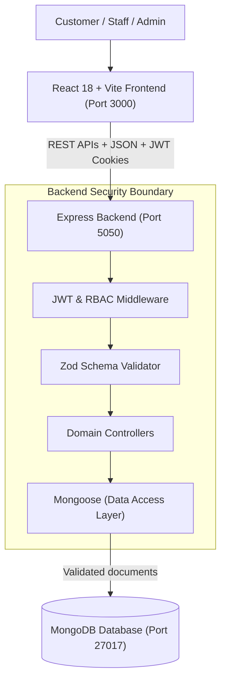
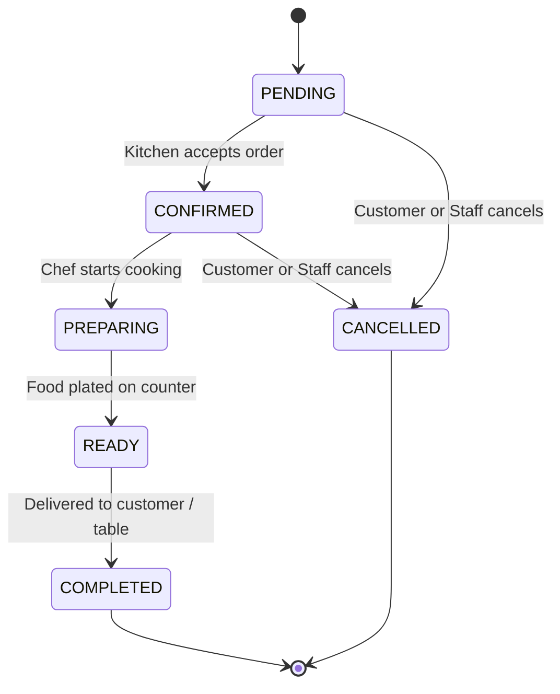

# Learning Guide — DineDesk Restaurant Platform

This learning guide provides an in-depth walkthrough of the design, architectural patterns, database modeling, security principles, and engineering decisions implemented in **DineDesk**. It is written for engineering students, junior developers, and code reviewers seeking to understand how modern full-stack web applications are structured in production.

---

## Table of Contents

1. [Architectural Overview & Data Flow](#1-architectural-overview--data-flow)
2. [Technology Stack & Why Each Was Chosen](#2-technology-stack--why-each-was-chosen)
3. [Document Modeling with Mongoose & MongoDB](#3-document-modeling-with-mongoose--mongodb)
4. [Critical Business Logic & Architectural Patterns](#4-critical-business-logic--architectural-patterns)
   - [A. Server-Side Price Recalculation (Zero-Trust Client)](#a-server-side-price-recalculation-zero-trust-client)
   - [B. Concurrency Control & Double-Booking Prevention](#b-concurrency-control--double-booking-prevention)
   - [C. Kitchen Display State Machine](#c-kitchen-display-state-machine)
   - [D. Simulated Payments](#d-simulated-payments)
5. [Security & Authentication Architecture](#5-security--authentication-architecture)
6. [Interactive Frontend Architecture](#6-interactive-frontend-architecture)
7. [Automated Testing Strategy](#7-automated-testing-strategy)
8. [Codebase Directory Walkthrough](#8-codebase-directory-walkthrough)

---

## 1. Architectural Overview & Data Flow

DineDesk follows a decoupled, three-tier client-server architecture:



### The Request Lifecycle
When a user interacts with the application (e.g., placing an order):
1. **Frontend Dispatch:** React validates UI constraints (party size, required fields) and dispatches an HTTP request with `fetch` and `credentials: "include"`.
2. **Reverse Proxy / CORS:** Vite's development proxy routes `/api` calls directly to `http://localhost:5050`. The Express server enforces CORS restrictions allowing only the configured frontend origin.
3. **Authentication & Authorization:** The `authenticate` middleware inspects the HttpOnly cookie or `Authorization: Bearer <token>` header. It validates the cryptographic signature using HMAC-SHA256 and attaches the user payload (`req.user`) to the request.
4. **Input Validation:** Request bodies pass through strict Zod schemas. Invalid payloads (e.g., negative quantities, malformed phone numbers) are rejected immediately with a structured 400 Bad Request error.
5. **Business Logic Execution:** The controller executes domain rules inside database transactions (e.g., querying current prices, locking table availability, creating order items).
6. **Data Persistence:** Mongoose validates documents and writes them to MongoDB.
7. **Response Formatting:** The API returns a consistent JSON response envelope: `{ success: true, data: { ... } }`.

---

## 2. Technology Stack & Why Each Was Chosen

| Layer | Chosen Technology | Why It Was Chosen |
|---|---|---|
| **Frontend Framework** | **React 18 + Vite 5** | Unmatched developer ergonomics, sub-second Hot Module Replacement (HMR), declarative UI state management, and modern component composition. |
| **Styling & Design** | **Tailwind CSS 3** | Utility-first CSS providing a bespoke, cohesive culinary theme (`cream`, `terracotta`, `charcoal`) without bulky CSS runtime overhead. |
| **Type Safety** | **TypeScript 5.x** | End-to-end interface contracts across frontend and backend, catching subtle runtime bugs at compile time. |
| **Backend Framework** | **Node.js + Express 4** | Lightweight, event-driven I/O model ideal for concurrent API requests, extensive ecosystem, and high performance. |
| **Database** | **MongoDB** | Flexible document model that keeps an order and its line items together, with unique indexes and multi-document transactions on replica sets. |
| **ODM** | **Mongoose 8** | Schema validation, TypeScript support, virtual populate for related documents, and index management. |
| **Validation** | **Zod** | Declarative schema validation ensuring incoming client payloads strictly adhere to expected types and ranges before reaching controllers. |

---

## 3. Document Modeling with Mongoose & MongoDB

The models live in `server/src/models`. Data that is always read together is embedded, and data with its own lifecycle gets a collection. [DATABASE_SCHEMA.md](DATABASE_SCHEMA.md) has the full reference.

### Key Entities

1. **User:** Stores credentials, name, phone number, and one of three roles: `CUSTOMER`, `KITCHEN_STAFF`, or `ADMIN`.
2. **MenuCategory & MenuItem:** Each dish references its category by ObjectId and tracks price, vegetarian flag, preparation time, and availability.
3. **RestaurantTable:** Physical tables with seat capacities and an `isActive` flag.
4. **Order:** Tracks dining type (`DINE_IN`, `PICKUP`, `DELIVERY`), status, totals, and delivery address. **Line items are embedded**, and each one snapshots the name and unit price charged, so later menu changes never alter past orders.
5. **Reservation:** Customer bookings for specific dates, time slots, guest counts, and tables.
6. **Payment:** Simulated payment record, one per order, with method, amount, status (`PENDING`, `SUCCESSFUL`, `FAILED`, `REFUNDED`), and references.
7. **OrderStatusHistory:** An append-only audit trail of every status change.

### Monetary Precision
Floating-point arithmetic is prone to rounding errors (e.g., `0.1 + 0.2 = 0.30000000000000004`). Prices and totals are stored in rupees as numbers, and every calculation is rounded to two decimal places as it happens, using the same formula on client and server.

---

## 4. Critical Business Logic & Architectural Patterns

### A. Server-Side Price Recalculation (Zero-Trust Client)
**The Vulnerability:** In insecure applications, the frontend calculates the cart total and submits `{ total: 10.00 }` to the server. Malicious actors can intercept the HTTP payload and modify the price to `$0.01`.

**DineDesk Solution:** The backend adheres to a **Zero-Trust Client Policy**:
1. The client sends *only* an array of item IDs, quantities, and dining mode:
   ```json
   { "items": [{ "menuItemId": "c1...", "quantity": 2 }] }
   ```
2. The server queries the database to retrieve the active prices for each ID.
3. The server validates that all items exist and are marked as `isAvailable: true`.
4. The server re-computes:
   $$\text{Subtotal} = \sum (\text{item.price} \times \text{quantity})$$
   $$\text{GST Tax} = \text{round}(\text{Subtotal} \times 0.05, 2)$$
   $$\text{Total} = \text{Subtotal} + \text{Tax} + \text{DeliveryFee}$$
5. The transaction proceeds using only the server-calculated values.

---

### B. Concurrency Control & Double-Booking Prevention
**The Problem:** Two customers attempting to reserve Table 4 for 7:00 PM on the same date could both receive confirmations if the system checks availability without isolation.

**DineDesk Solution:** two layers work together.
1. **Partial unique index.** MongoDB enforces uniqueness on `(tableId, reservationDate, reservationTime)` for reservations with `holdsSlot: true`. That field is true only while the booking is `PENDING` or `CONFIRMED`. MongoDB itself rejects a second active booking, even if a future code path forgets to check.
2. **Try the next table.** Auto-allocation attempts each suitable table in order, so a request that loses one table moves on to the next.

A request that loses the race receives HTTP 409 Conflict.

**Limitation:** bookings are compared by exact date and time. There is no dining duration, so 19:00 and 19:30 on one table do not conflict.

---

### C. Kitchen Display State Machine
Kitchen orders must progress through a predictable lifecycle. Invalid status jumps (such as jumping directly from `PENDING` to `COMPLETED` without preparation, or reversing a `COMPLETED` order) undermine operational efficiency.

**The State Transition Graph:**


**Implementation in Controller:**
```typescript
const validTransitions: Record<OrderStatus, OrderStatus[]> = {
  PENDING: [OrderStatus.CONFIRMED, OrderStatus.CANCELLED],
  CONFIRMED: [OrderStatus.PREPARING, OrderStatus.CANCELLED],
  PREPARING: [OrderStatus.READY, OrderStatus.CANCELLED],
  READY: [OrderStatus.COMPLETED, OrderStatus.CANCELLED],
  COMPLETED: [],
  CANCELLED: []
};
```
Any status update violating these allowed transitions is rejected with HTTP 400 Bad Request. The update is also conditional on the status that was read, so if two people act on the same order at once, only one succeeds and the other receives HTTP 409.

---

### D. Simulated Payments
Payments are simulated directly in the order and payment controllers. There is no adapter layer and no gateway integration.
- Choosing an online method records a `SUCCESSFUL` payment with a generated `TXN-...` reference and confirms the order.
- `simulatePaymentFailure: true` on order creation records a `FAILED` payment and leaves the order `PENDING`. `POST /payments/checkout` retries it, and its `simulateFailure` flag returns HTTP 402.
- Cash stays `PENDING` until the kitchen completes the order.
- Integrating a real gateway would require replacing this controller logic and adding webhook verification.

---

## 5. Security & Authentication Architecture

1. **Password Hashing:** Passwords are hashed with `bcryptjs` using a salt work factor of 10. Raw passwords are never stored in the database.
2. **Stateless JWT with Dual Transport:**
   - Tokens are issued in **HttpOnly cookies**, which page JavaScript cannot read. The browser client relies on the cookie alone and never stores the token.
   - In addition, the API supports the standard `Authorization: Bearer <token>` header for headless API consumers and testing tools.
3. **Role-Based Access Control (RBAC):**
   - Routes are secured with granular role guards:
     - `authorize(Role.ADMIN)` for menu item creation, price editing, and analytics.
     - `authorize([Role.KITCHEN_STAFF, Role.ADMIN])` for kitchen KDS tickets.
     - `authenticate` for order and reservation history.
4. **Input Safety:** Zod rejects query-operator objects before they reach Mongoose, and search text is escaped before it is used in a regular expression.

---

## 6. Interactive Frontend Architecture

1. **Global State via React Context:**
   - `AuthContext`: Tracks the authenticated user and exposes one-click demo login shortcuts in development.
   - `CartContext`: Manages local shopping cart state, quantity manipulation, dining mode selection, and persists selections in `localStorage`.
2. **Responsive Culinary Theme:**
   - Designed using Tailwind CSS with custom palette:
     - Deep Terracotta (`#C2410C`): Primary action accents.
     - Warm Cream (`#FDFBF7`): Background canvas.
     - Slate Charcoal (`#1E293B`): Legible, high-contrast typography.
3. **Status Polling:**
   - The order tracker and kitchen board request fresh data every 4 seconds with `setInterval` and stop when the page is left. This is periodic polling. The project does not use WebSockets or Server-Sent Events.

---

## 7. Automated Testing Strategy

DineDesk includes a comprehensive test suite using **Vitest** and **Supertest** (`server/tests/api.test.ts`) run against a separate test database:
- **Server Health & CORS Security:** Valid configured origin allowed with credentials, unauthorized origins rejected with HTTP 403.
- **Authentication:** Registration, login with valid credentials, rejection of bad passwords, token verification.
- **Menu System:** Category listing, dish retrieval, availability flags, vegetarian filtering.
- **Order Pipeline:** Server-side price recalculation, order creation, transaction persistence, invalid status rejection, private order authorization (HTTP 401/403).
- **Kitchen Workflow:** KDS queue retrieval, the full `PENDING` → `COMPLETED` lifecycle, invalid jumps, and simultaneous updates.
- **Reservations & Concurrency:** Table availability queries, party size limits, double-booking rejection, concurrent booking, and the database-level unique index.
- **Payments:** Mock payment authorization and simulated decline handling.
- **Admin Metrics:** Revenue calculations and catalog manipulation permissions.

Run tests anytime with:
```powershell
npm run test
```

---

## 8. Codebase Directory Walkthrough

```text
Task2-Restaurant-Ordering/
├── client/                     # Frontend Application
│   ├── src/
│   │   ├── components/         # Reusable UI widgets (Navbar, Footer, MenuCard, Modal)
│   │   ├── context/            # Global Auth and Cart state providers
│   │   ├── pages/              # Home, Menu, Cart, Checkout, OrderTracker, MyOrders,
│   │   │                       # Reservations, MyReservations, Kitchen, Admin, Login, Register
│   │   ├── services/api.ts     # Centralized fetch client that sends the auth cookie
│   │   └── types/index.ts      # TypeScript models (Order, MenuItem, Reservation, User)
│
├── server/                     # Backend API & Database Service
│   ├── src/
│   │   ├── models/             # Mongoose schemas, enums, and indexes
│   │   ├── seed/               # Fictional demo data and seeding logic
│   │   ├── scripts/            # Seed command and PostgreSQL data migration tool
│   │   ├── services/           # Order status transitions
│   │   ├── db.ts               # Connection, health check, and transactions
│   │   ├── controllers/        # Domain controllers (auth, menu, orders, kitchen, etc.)
│   │   ├── middleware/         # Auth guards, role checks, error handler
│   │   ├── routes/             # REST endpoint routing definitions
│   │   ├── utils/              # JWT helpers, ApiError classes, access and date helpers
│   │   ├── app.ts              # Express application configuration
│   │   └── server.ts           # Server port listener (5050)
│   └── tests/api.test.ts       # Automated integration tests
│
└── docs/                       # Comprehensive Engineering Documentation
    ├── ARCHITECTURE.md         # Detailed architectural blueprint
    ├── API_SPECIFICATION.md    # Complete OpenAPI-style endpoint documentation
    ├── DATABASE_SCHEMA.md      # Data dictionary, relations, and ER diagram
    ├── TESTING_REPORT.md       # Vitest test execution report
    ├── DEMO_VIDEO_OUTLINE.md   # Step-by-step submission video script
    └── LEARNING_GUIDE.md       # This comprehensive engineering guide
```
