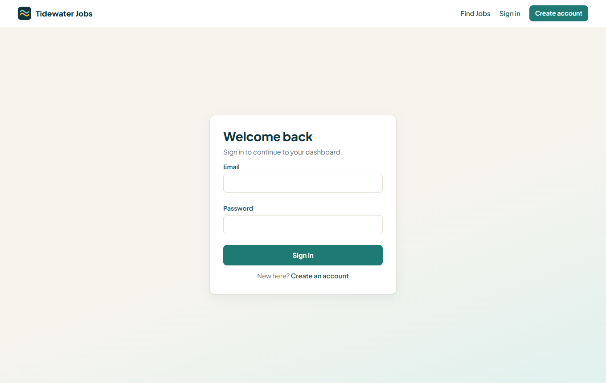
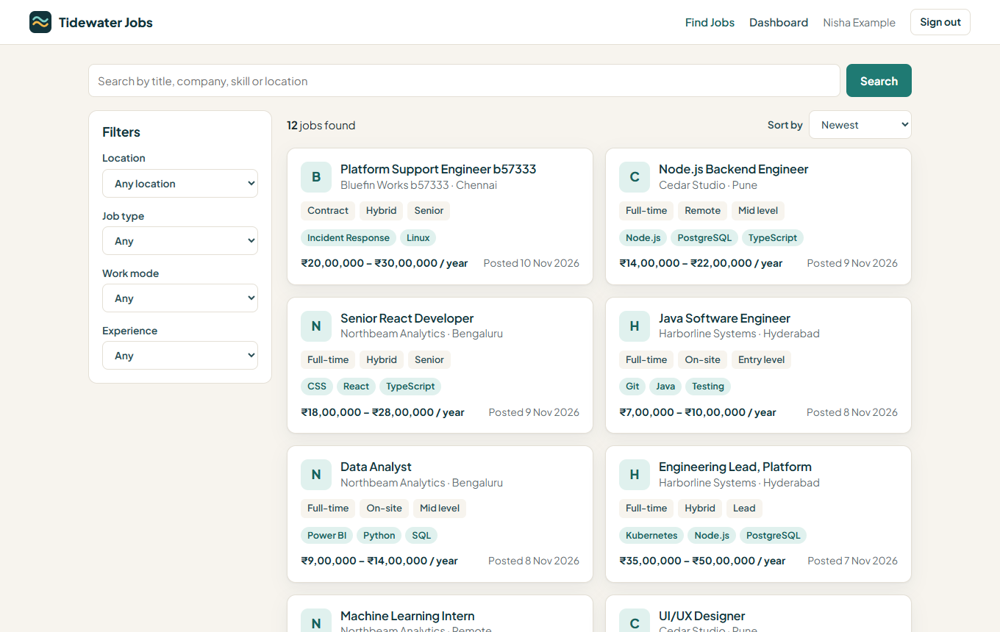
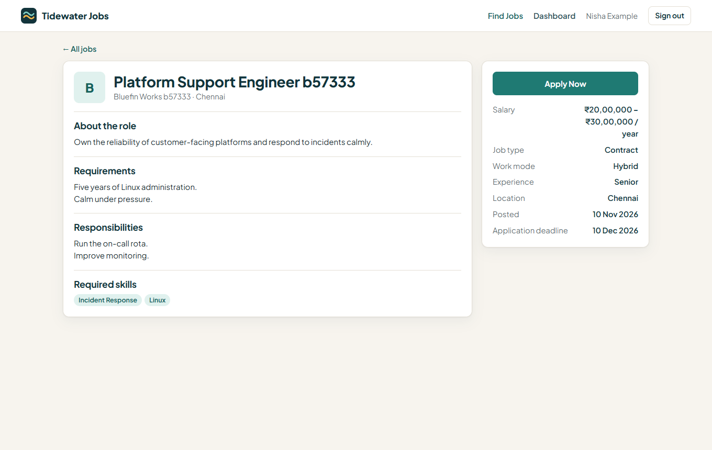
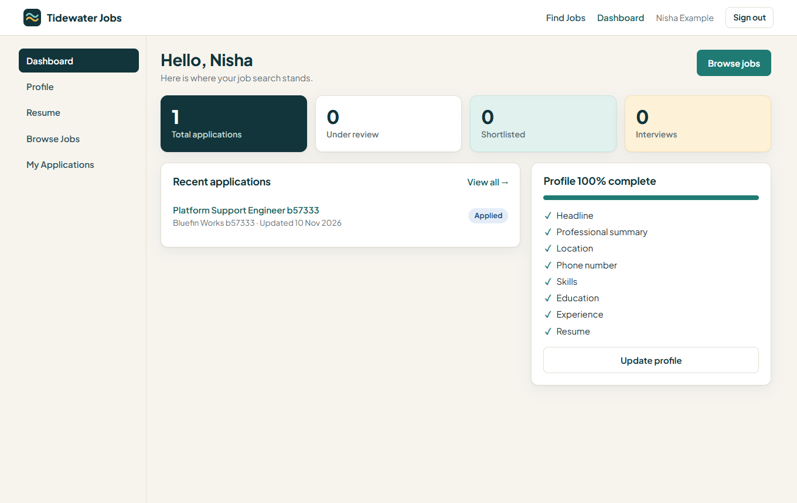
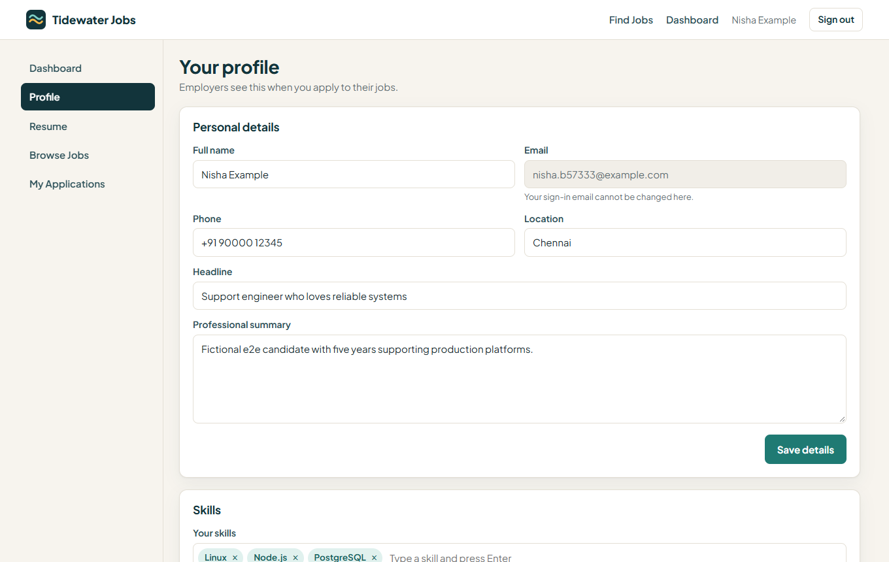
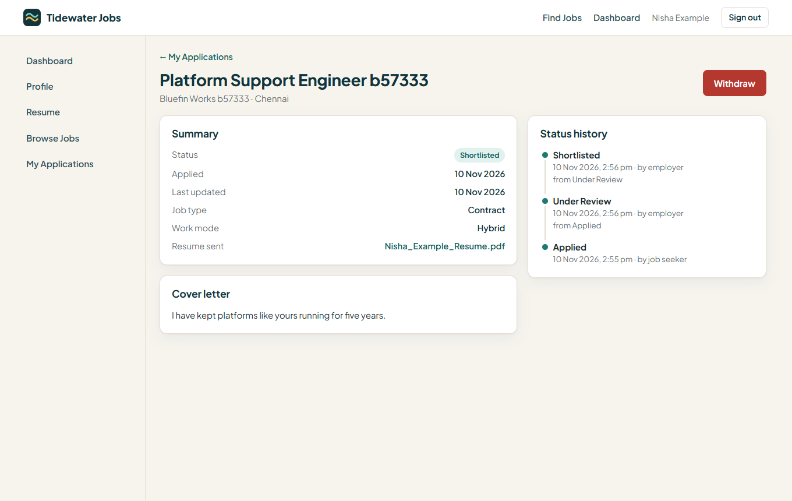
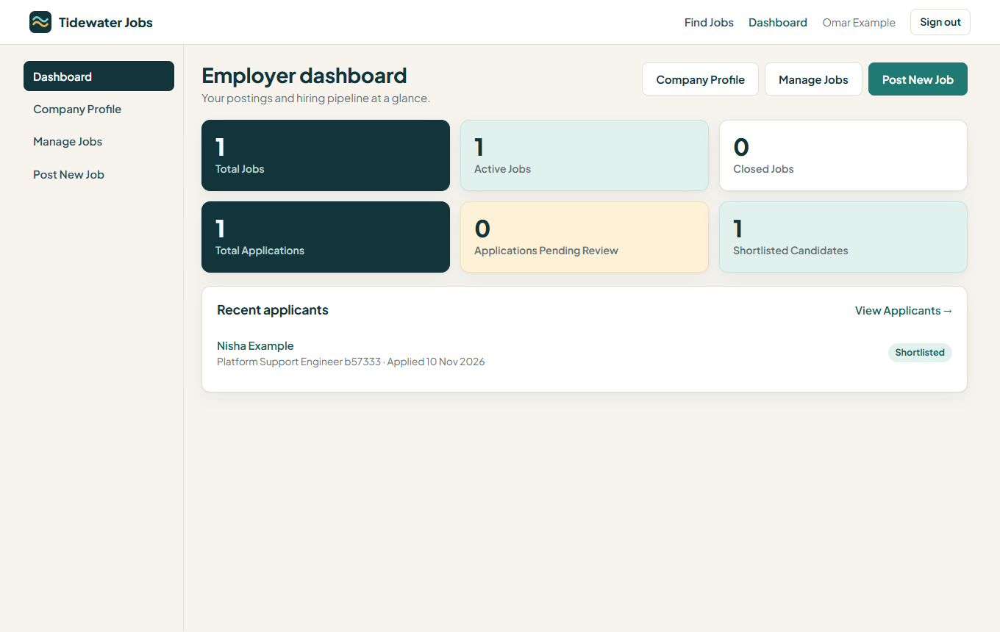
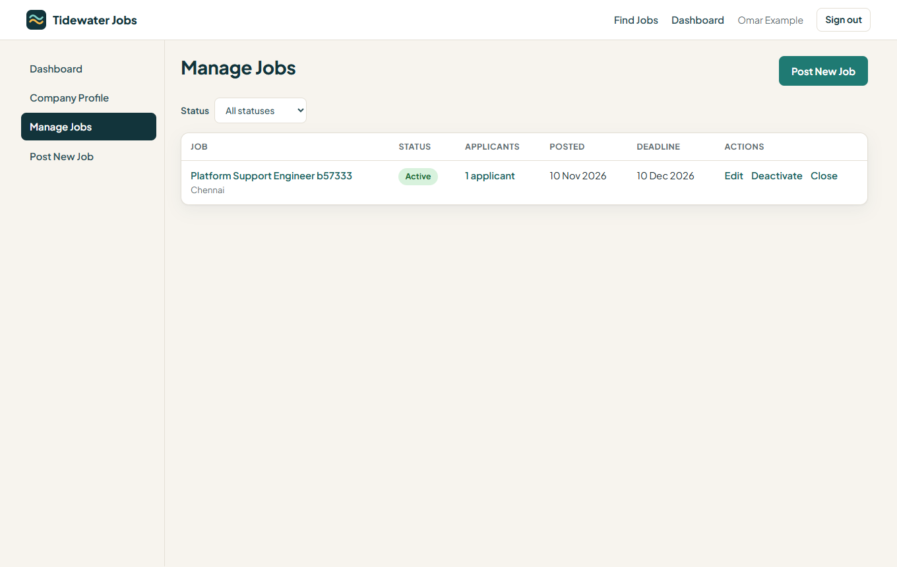
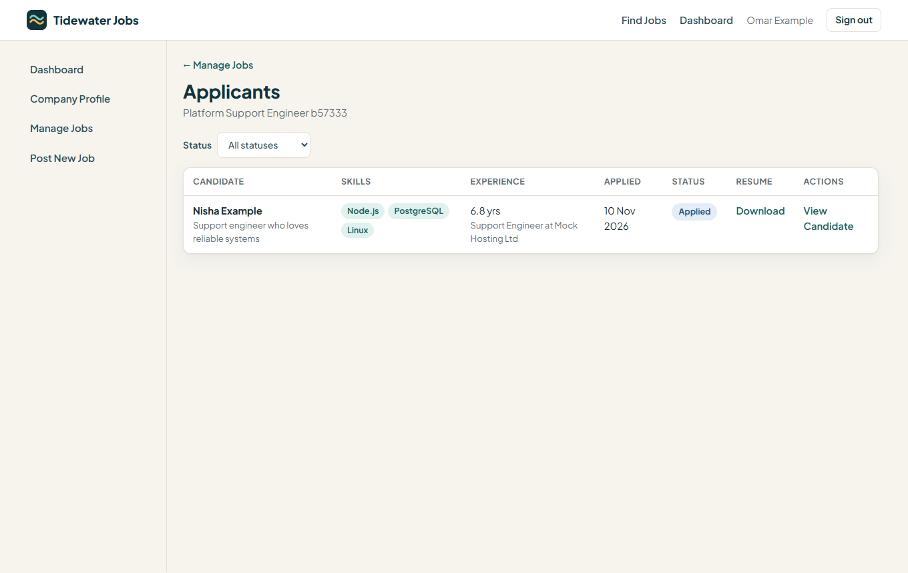
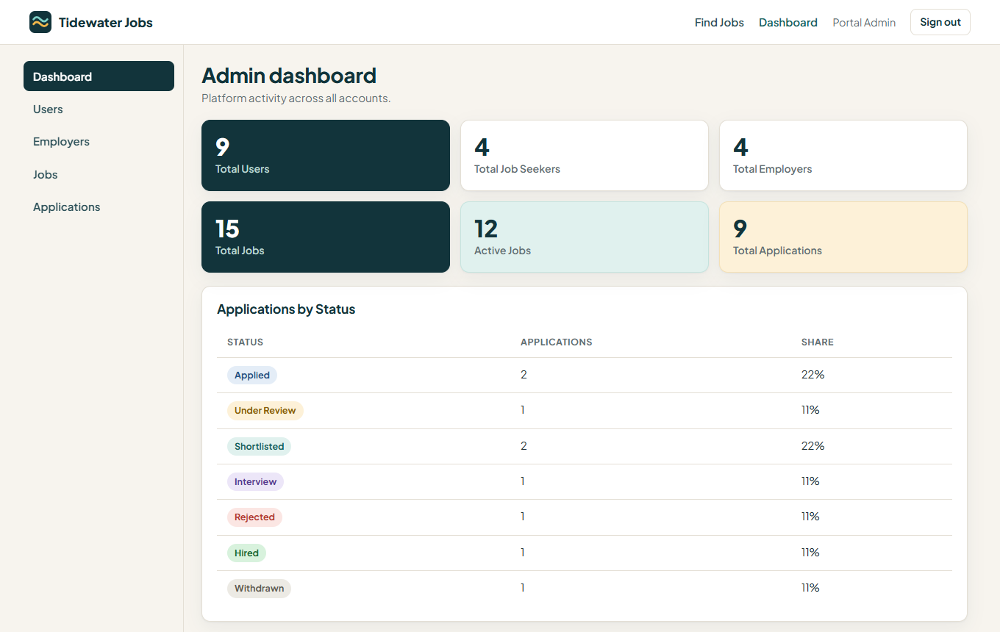

# Tidewater Jobs: Job Portal

CodSoft Full Stack Web Development Internship, Task 3.

## Project Overview

Tidewater Jobs is a full-stack job portal. Job seekers build a profile, upload a resume, search open roles, apply and follow each application. Employers publish jobs and move candidates through a hiring pipeline. Administrators moderate the platform. All data comes from a real Express API and MongoDB database.

## Features

**Job seekers:** registration and sign-in, profile with relational skills, education and experience, resume upload and replacement, job search with filters, sorting and pagination, applying with a cover letter, application tracking with status history, withdrawal.

**Employers:** company profile, job creation and editing, activation, deactivation, closing and deletion, applicant lists, candidate profiles, resume access, validated status updates, dashboard totals.

**Admins:** platform statistics, user activation and deactivation, employer overview, job moderation with a recorded reason, all applications.

## User Roles

| Role | How it is created | Access |
| --- | --- | --- |
| `JOB_SEEKER` | Registration | Own profile, resume and applications |
| `EMPLOYER` | Registration | Own company, jobs and the applications to those jobs |
| `ADMIN` | Seed script only | Platform management |

## Technology Stack

| Area | Technology |
| --- | --- |
| Frontend | React 19, TypeScript, Vite, React Router |
| Backend | Node.js, Express 5, TypeScript |
| Database | MongoDB (replica set), Prisma 6 |
| Authentication | JWT in an HttpOnly cookie, bcrypt |
| Validation | Zod |
| File uploads | Multer |
| Testing | Vitest, Supertest, Testing Library |

## Architecture

The browser talks to one origin. Vite's dev and preview servers forward `/api` to Express, which applies authentication, role checks and validation before services read or write MongoDB through Prisma. Details are in [docs/architecture.md](docs/architecture.md).

## Database Schema

Main collections: `User`, `JobSeekerProfile`, `EmployerProfile`, `Company`, `Skill`, `JobSkill`, `JobSeekerSkill`, `Job`, `Education`, `Experience`, `Resume`, `Application`, `ApplicationStatusHistory`. A candidate can apply to a job only once, enforced by a MongoDB unique index. The diagram and integrity rules are in [docs/database.md](docs/database.md).

## Authentication

`POST /api/auth/login` verifies the bcrypt hash and sets a signed JWT in a cookie that is `HttpOnly`, `SameSite=Strict`, and `Secure` in production. The token is never returned in a response body or stored in browser storage. Each request reloads the user from the database, so deactivating an account takes effect immediately. Role and ownership rules are enforced on the server for every protected endpoint.

## API Overview

| Prefix | Purpose |
| --- | --- |
| `/api/health` | Service and database status |
| `/api/auth` | Register, login, logout, current user |
| `/api/users` | Account name and password |
| `/api/job-seekers` | Profile, skills, education, experience, resume, dashboard |
| `/api/employers` | Contact details, dashboard, own jobs |
| `/api/companies` | Own company and public company details |
| `/api/jobs` | Search, details, management, applicants |
| `/api/applications` | Apply, track, withdraw, status updates, resume access |
| `/api/admin` | Statistics and moderation |

The complete list is in [docs/api.md](docs/api.md).

## Setup Instructions

Requires Node.js 20 or newer and MongoDB running as a replica set. It was verified on Node.js 24 and MongoDB 7.0. Run these from `Task3-Job-Portal`.

```bash
cd server
npm install
cp .env.example .env
```

```bash
cd client
npm install
```

On Windows PowerShell, use `Copy-Item .env.example .env` for the copy step. Then edit `server/.env` as described below.

## Environment Variables

All are set in `server/.env`. Never commit that file.

| Variable | Purpose |
| --- | --- |
| `DATABASE_URL` | MongoDB connection string, including the database name |
| `TEST_DATABASE_URL` | Separate MongoDB database for tests. The name must contain `test` and differ from `DATABASE_URL` |
| `JWT_SECRET` | Random secret of at least 32 characters |
| `JWT_EXPIRES_IN_HOURS` | Session length, default 24 |
| `CLIENT_ORIGIN` | Allowed browser origins, comma separated |
| `PORT` | API port, default 4000 |
| `BCRYPT_ROUNDS` | Hash cost, default 12 |
| `AUTH_RATE_LIMIT_WINDOW_MS`, `AUTH_RATE_LIMIT_MAX` | Limit on authentication attempts |
| `TRUST_PROXY_HOPS` | Reverse proxies in front of the API, default 0 |
| `UPLOAD_DIR`, `MAX_RESUME_SIZE_MB` | Private resume folder and size limit |
| `ALLOW_DEMO_SEED` | Must be `true` to seed demo accounts in production |

`client/.env` is optional. `API_PROXY_TARGET` changes where `/api` is forwarded.

## Database Setup

Prisma uses multi-document transactions, which MongoDB offers only on a replica set. A standalone server will not work, and the API refuses to start on one. The steps below run a dedicated single-node replica set on port 27018, leaving any existing MongoDB service untouched. Create the data folder, then start the server and leave it running:

```bash
mkdir D:/mongo-data/job-portal
```

```bash
mongod --replSet rs0 --port 27018 --bind_ip 127.0.0.1 --dbpath D:/mongo-data/job-portal
```

In a second terminal, initialize the replica set once. Later starts only need the `mongod` command above.

```bash
mongosh --port 27018 --eval "rs.initiate({_id:'rs0',members:[{_id:0,host:'127.0.0.1:27018'}]})"
```

On Windows, `mongod` is usually in `C:\Program Files\MongoDB\Server\<version>\bin`. MongoDB creates the databases automatically, so no create-database step is needed. The connection strings in `.env.example` match these commands. If you use a hosted or password-protected server, put its connection string only in `server/.env`.

## Schema Setup

MongoDB has no SQL migrations. This command creates the collections and indexes and applies the validation rules. Run it after installing and whenever `schema.prisma` changes.

```bash
cd server
npm run db:generate
npm run db:setup
```

## Seed

```bash
cd server
npm run db:seed
```

The seed can be run repeatedly without creating duplicates.

## Reset

This erases the database in `DATABASE_URL`, then recreates and reseeds it. You must repeat the database name to confirm, and it refuses to run with `NODE_ENV=production`. Uploaded resume files are not deleted.

```bash
cd server
npm run db:reset -- --confirm job_portal
```

## Run Backend

```bash
cd server
npm run dev
```

The API listens on http://localhost:4000, and `GET /api/health` reports its status.

For a production build:

```bash
cd server
npm run build
npm start
```

## Run Frontend

```bash
cd client
npm run dev
```

Open http://localhost:5173. To serve the production build, run `npm run build` and then `npm run preview`.

## Test Commands

```bash
cd server
npm test
```

```bash
cd client
npm test
```

`npm run typecheck` and `npm run lint` work in both folders. See [docs/testing.md](docs/testing.md).

## Demo Accounts

These fictional accounts exist only after running the seed, and are for local demonstration. The password for all of them is `Demo@12345`. Never seed them into a real deployment.

| Role | Email |
| --- | --- |
| Admin | `admin@jobportal.example` |
| Employer | `hiring@northbeam.example` |
| Employer | `hiring@cedarstudio.example` |
| Employer | `hiring@harborline.example` |
| Job seeker | `aarav.seeker@jobportal.example` |
| Job seeker | `meera.seeker@jobportal.example` |
| Job seeker | `kabir.seeker@jobportal.example` |

## Screenshots

Captured from the running application with fictional data.

| | |
| --- | --- |
|  |  |
|  |  |
|  |  |
|  |  |
|  |  |

## Security

- Passwords hashed with bcrypt and never returned by the API.
- JWT held only in an `HttpOnly`, `SameSite=Strict` cookie, `Secure` in production.
- Role and ownership checks on the server. Client-supplied user identifiers are ignored.
- Zod validation of bodies, query strings and parameters. Queries are built through Prisma, never from concatenated user input.
- CORS limited to `CLIENT_ORIGIN`. Security headers from Helmet.
- Rate limiting on registration, login and password change.
- Resumes checked for extension, MIME type, file signature, size and filename, then stored under generated names outside any public path. They are served only after an authorization check.
- Central error handling that returns safe messages without stack traces or internal details.
- Secrets come from environment variables. Only `.env.example` files are tracked.

## Known Limitations

- MongoDB has no foreign keys, so relations and cascades are enforced by Prisma Client. Changes made directly in the database bypass them. Unique indexes and collection validators still apply.
- Resumes are validated but not virus scanned, and are stored on the API server's local disk.
- Rate limits are held in memory per server process.
- A deployment must serve the client and API from the same site, because the session cookie is `SameSite=Strict`.
- Salaries are displayed in Indian rupees per year.
- Each employer account manages one company.
- There are no email notifications or real-time updates.

## Project Structure

```text
Task3-Job-Portal/
├── client/                 React application
│   └── src/
│       ├── api/            API client and endpoint functions
│       ├── components/     Shared UI, layout, route guard
│       ├── context/        Auth and toast providers
│       ├── hooks/          Data loading and form actions
│       ├── lib/            Labels and formatting
│       ├── pages/          public, jobseeker, employer, admin
│       └── test/           Frontend tests
├── server/                 Express API
│   ├── prisma/             Schema, validators, setup, reset, seed
│   ├── src/
│   │   ├── config/         Environment validation
│   │   ├── controllers/    Request handlers
│   │   ├── db/             Prisma client
│   │   ├── middleware/     Auth, uploads, errors
│   │   ├── routes/         URL definitions
│   │   ├── services/       Business logic and data access
│   │   ├── utils/          Tokens, errors, file checks
│   │   └── validation/     Zod schemas
│   └── tests/              Backend tests
└── docs/                   Architecture, API, database, testing, screenshots
```
