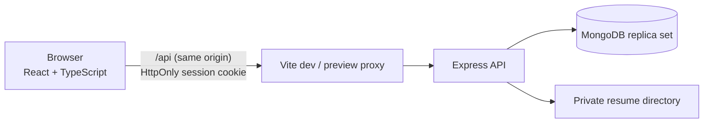

# Architecture

Tidewater Jobs is a single-page React client talking to a stateless Express REST API, which stores data in MongoDB through Prisma. Uploaded resumes live on the API server's disk, outside any public path.

## Backend layers

A request passes through these layers, and each has one job.

| Layer | Folder | Responsibility |
| --- | --- | --- |
| Routes | `server/src/routes` | Map URLs to controllers and attach authentication and role checks |
| Middleware | `server/src/middleware` | Session lookup, role checks, upload limits, central error handling |
| Validation | `server/src/validation` | Zod schemas for every body, query string and URL parameter |
| Controllers | `server/src/controllers` | Parse input, call one service, send the response |
| Services | `server/src/services` | Business rules, ownership checks and all Prisma access |
| Utilities | `server/src/utils` | Tokens, API errors, pagination, resume file checks |

## Frontend structure

- `client/src/api` is the only code that calls `fetch`. It converts failures into a typed `ApiError` and signals expired sessions.
- `client/src/context` holds the signed-in user and toast notifications. No other global state exists.
- `client/src/hooks` provides `useAsync` for loading data and `useAction` for submitting it.
- `client/src/pages` has one folder per audience: `public`, `jobseeker`, `employer`, `admin`.

## Key decisions

- **Same-origin requests.** The Vite dev and preview servers proxy `/api`, so the browser always sends the `SameSite=Strict` cookie. A production deployment needs the same arrangement through a reverse proxy.
- **Session checked on every request.** The JWT only identifies the user. The user row is reloaded per request, so deactivation takes effect immediately.
- **Resume versions.** `JobSeekerProfile.currentResumeId` points at the current resume. Replacing it keeps older files only if an application still references them, so employers see what was actually submitted.
- **Expiry in two places.** Reads compare the deadline directly, so a job closes on time. A sweep every 15 minutes, and before employer and admin views, updates the stored status.
- **Concurrency handled in the database.** Duplicate applications are settled by a unique index. Status changes filter on the expected current status inside a transaction, so a stale update fails instead of overwriting. Transactions that MongoDB aborts for a write conflict are retried.
- **Search without joins.** MongoDB has no joins, and Prisma's generated query fails for relation filters inside `OR`. Searches that span collections first look up matching company, skill, job or user IDs, then filter on those IDs.
