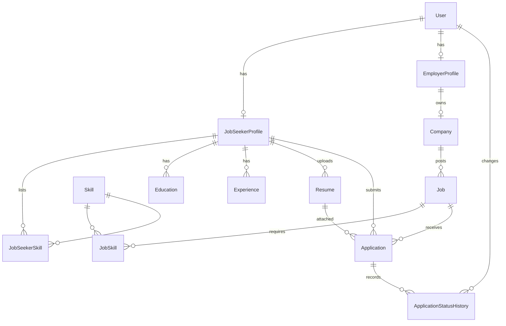

# Database

MongoDB, accessed through Prisma's MongoDB connector. The schema is in `server/prisma/schema.prisma`. `npm run db:setup` creates the collections and indexes with `prisma db push`, then applies the rules in `server/prisma/validators.ts`.

The server must be a replica set, because Prisma uses multi-document transactions. A single node is enough for local work.

## Collections

| Collection | Purpose |
| --- | --- |
| `User` | Account, role, active flag and bcrypt hash |
| `JobSeekerProfile` | Contact details, headline, summary, reference to current resume |
| `EmployerProfile` | Recruiter contact details |
| `Company` | One company per employer |
| `Skill` | Canonical skills, unique by lowercase name |
| `JobSeekerSkill`, `JobSkill` | Links between skills and profiles or jobs |
| `Job` | Posting with status, deadline, publish date and moderation fields |
| `Education`, `Experience` | Candidate history |
| `Resume` | File metadata. The stored name is generated by the server |
| `Application` | Candidate, job, submitted resume, cover letter, status |
| `ApplicationStatusHistory` | Previous status, new status, who changed it and when |

Related data stays in separate collections so every Prisma model and API response keeps its shape. IDs are UUID strings stored in `_id`, so the API's identifier format matches what clients already use.

## How integrity rules are enforced

| Rule | Mechanism |
| --- | --- |
| One application per candidate per job | Unique index on `(jobId, candidateId)` |
| Unique email, one profile per user, one company per employer | Unique indexes |
| One link per skill and job, or skill and profile | Compound unique indexes |
| Skill names unique regardless of case | Unique index on `normalizedName` |
| `salaryMin <= salaryMax`, salaries not negative | Collection validator on `Job` |
| End dates not before start dates | Collection validators on `Education` and `Experience` |
| A current job has no end date | Collection validator on `Experience` |
| A job with applications cannot be deleted | Application check, plus Prisma's emulated `Restrict` |
| Referenced records exist | Application checks and Prisma relations |
| Cascading deletes and set-null | Emulated by Prisma Client |

MongoDB has no foreign keys. Relation rules apply only to writes made through Prisma, so editing documents directly can leave references pointing at missing records.

`currentResumeId` is indexed but not unique: a MongoDB unique index counts absent values as equal, which would allow only one profile without a resume. Each profile holds a single reference, and the application only ever points it at that profile's own resume.

## Working with optional fields

Prisma omits optional fields left out on create. Two MongoDB behaviours follow, and queries on optional fields must handle both:

- `{ field: null }` matches explicit nulls but not absent fields, so also test `{ field: { isSet: false } }`.
- Range comparisons sort absent and null values below dates, so an upper-bound filter also needs a lower bound.

## Indexes

Foreign-key style lookups, job search filters (`status + publishedAt`, `jobType`, `workMode`, `experienceLevel`, `location`, `expiresAt`), `Company.name`, and application status per job and per candidate. Text filters use case-insensitive matching, which scans rather than using an index.

## Commands

| Command | Effect |
| --- | --- |
| `npm run db:generate` | Generates Prisma Client |
| `npm run db:setup` | Creates collections and indexes, and applies validators |
| `npm run db:seed` | Loads demo data without creating duplicates |
| `npm run db:reset -- --confirm <name>` | Erases the database in `DATABASE_URL`, then sets it up and seeds it. Refused in production |

## Seed data

`npm run db:seed` creates fictional accounts, three companies, 14 jobs in every status and eight applications at varied stages. Records are matched on stable keys, so running it again creates no duplicates. It refuses to run with `NODE_ENV=production` unless `ALLOW_DEMO_SEED=true`.

## Moving existing PostgreSQL data

There is no automated import. Earlier PostgreSQL data does not carry over. Because IDs are still UUID strings, an export can be loaded by writing each row's `id` to `_id`, loading each table into the collection of the same name, and adding an `_id` to `JobSkill` and `JobSeekerSkill` rows, then running `npm run db:setup`. Resume files in the upload folder can stay where they are.
