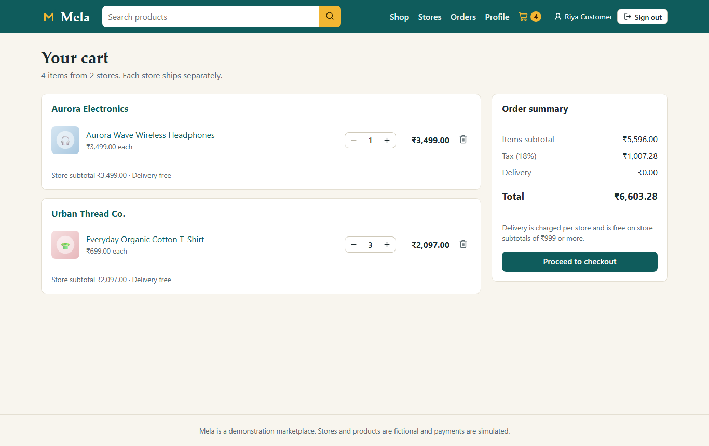
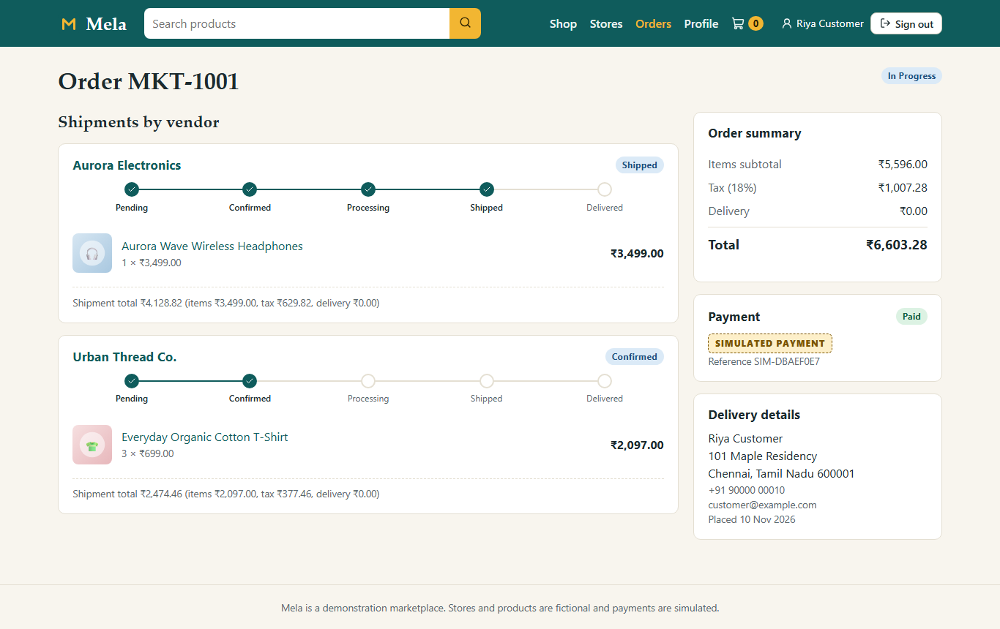
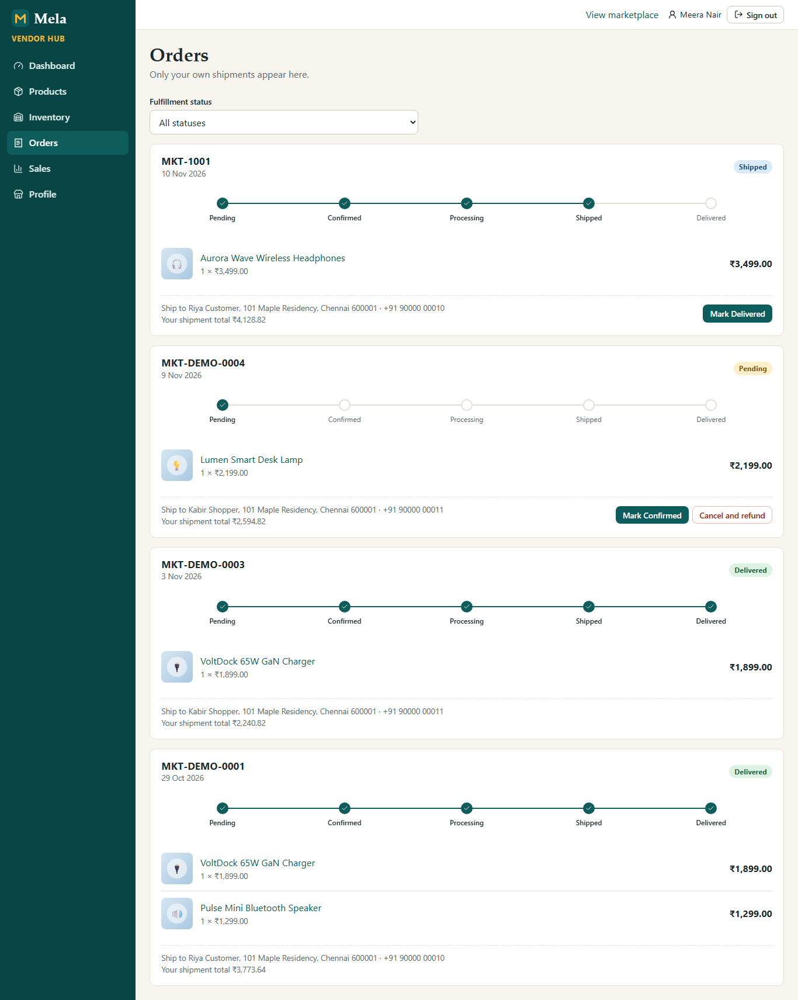

# Mela — Multi-Vendor Marketplace

[](https://react.dev/)
[](https://www.typescriptlang.org/)
[](https://vitejs.dev/)
[](https://expressjs.com/)
[](https://www.mongodb.com/)
[](https://mongoosejs.com/)
[](../LICENSE)

A full-stack multi-vendor marketplace built for the **CodSoft Full Stack Web Development Internship (Task 4)**. Customers buy from many independent stores in one cart and one checkout. The backend splits each order into a separate shipment per vendor, and each vendor fulfils only its own shipment. Administrators approve stores and oversee the whole marketplace.

This is an internship demonstration project. **Payments are simulated:** no payment gateway is connected and no money is charged. All stores, products and people in the demo data are fictional.

---

## Features

### Customer
- Registration, login, logout, and a session kept in an HttpOnly cookie.
- Catalog with search, category, vendor, price, availability and sort filters, and pagination. All filtering runs on the server.
- Product details with reviews, and a storefront page for each vendor.
- One cart across vendors, grouped by vendor, with live stock and availability checks.
- One checkout with 18% tax and a ₹49 delivery fee per vendor, free when that vendor's subtotal is ₹999 or more. The server calculates every amount.
- A clearly labelled **simulated payment** with success and failure paths. A failed payment releases the stock and returns the items to the cart.
- Order history, with each vendor's shipment tracked separately.
- Reviews for products the customer has received, one per product.

### Vendor
- Registration as a store, which starts as pending until an admin approves it.
- Dashboard with revenue, order counts and low-stock alerts for their own store only.
- Products: create, edit, deactivate, manage images and assign categories.
- Inventory: stock adjustments that are applied atomically.
- Orders: move their own shipments through `PENDING → CONFIRMED → PROCESSING → SHIPPED → DELIVERED`, or cancel and refund their share.
- Sales page with daily revenue and top products.

### Admin
- Marketplace statistics: users, vendors, pending approvals, products, orders and revenue net of refunds.
- Vendors: approve, reject, suspend and reactivate.
- Users: change permitted roles and deactivate accounts. Admins cannot change their own role or status.
- Categories: create, edit, activate and deactivate.
- Products: view all, including inactive ones, and activate or deactivate any listing.
- Orders: view every order with its customer, vendors, fulfillment status, payment status and totals.

---

## Technology Stack

| Layer | Technology |
|---|---|
| Frontend | React 19, TypeScript 6, Vite 8, React Router, CSS, Lucide icons |
| Backend | Node.js, Express 5, TypeScript 6, Zod validation |
| Database | MongoDB with Mongoose 9 |
| Authentication | JWT in an HttpOnly cookie, bcrypt password hashing, role-based authorization |
| Testing | Vitest and Supertest (backend), Vitest and React Testing Library (frontend) |

Verified with Node.js 24 and MongoDB 7.0.

---

## Architecture Overview

```text
Browser (React SPA, :5184) --/api proxy--> Express REST API (:4004) --Mongoose--> MongoDB
```

- **Frontend:** a React Router app. Vite forwards `/api` to Express, so the browser talks to one origin.
- **API:** `routes → middleware (authenticate, role and vendor checks) → services`. Every request body and query is validated with Zod.
- **Orders:** one order document per checkout, with an embedded shipment for each vendor holding its own items, totals, status and status history. A vendor's update matches only its own shipment.
- **Inventory:** stock is reduced with a conditional atomic update that only succeeds while enough stock remains, which prevents overselling.
- **Data:** users, vendors, categories, products, carts, orders, payments and reviews, linked by ObjectId. See [DATABASE_SCHEMA.md](DATABASE_SCHEMA.md).

```text
Task4-Multi-Vendor-Marketplace/
├── client/
│   ├── public/catalog/  # fictional product, category and vendor artwork
│   └── src/             # api, components, hooks, layouts, pages, routes, services, test
├── server/
│   ├── src/             # config, models, middleware, routes, services, seed, scripts, utils, app.ts, server.ts
│   └── tests/           # backend tests and helpers
├── screenshots/         # captures from the running application
└── package.json         # root orchestration scripts
```

Further reading: [Architecture](ARCHITECTURE.md), [API specification](API_SPECIFICATION.md), [Database schema](DATABASE_SCHEMA.md), [Testing report](TESTING_REPORT.md), [Learning guide](LEARNING_GUIDE.md), [Demo video outline](DEMO_VIDEO_OUTLINE.md).

---

## Setup

### Prerequisites
- Node.js 20 or newer, and npm.
- A running MongoDB server on port 27017. A standalone server works. On a replica set, checkout automatically uses real transactions (see Transactions below).

### 1. Install dependencies
```powershell
git clone https://github.com/srisnigdha-08/CodSoft-Internship.git
cd CodSoft-Internship/Task4-Multi-Vendor-Marketplace
npm run install:all
```

### 2. Configure the environment
```powershell
Copy-Item server/.env.example server/.env
```
Edit `server/.env` and set `JWT_SECRET`. Generate it with:
```powershell
node -e "console.log(require('crypto').randomBytes(48).toString('hex'))"
```

| Variable | Required | Purpose |
|---|---|---|
| `JWT_SECRET` | Yes | Signs JWTs. At least 32 characters, with no default. The server refuses to start without it |
| `MONGODB_URI` | Yes, outside tests | Development database, `codsoft_marketplace` |
| `CLIENT_ORIGINS` | Yes | Comma-separated browser origins allowed to call the API |
| `MONGODB_TEST_URI` | For tests | Must name `codsoft_marketplace_test` |
| `PORT` | No | API port, default 4004 |
| `NODE_ENV` | No | `development`, `test` or `production` |
| `JWT_EXPIRES_IN_HOURS` | No | Session length, default 24 |
| `BCRYPT_ROUNDS` | No | Hashing cost, default 12 |
| `AUTH_RATE_LIMIT_MAX` | No | Login and registration attempts per IP per 15 minutes, default 20 |

`.env` files are git-ignored. Never commit real credentials.

### 3. Seed demo data
```powershell
npm run seed
```

MongoDB creates the `codsoft_marketplace` database on first use, and Mongoose builds the indexes when the app connects. Run `npm run db:indexes` in `server/` to sync them explicitly. The seed is fictional and safe to re-run: it creates only what is missing, deletes nothing, and refuses to run with `NODE_ENV=production` or against any other database.

### 4. Run the app
In two terminals:
```powershell
npm run dev:server
```
```powershell
npm run dev:client
```
Open **http://localhost:5184**. The API listens on http://localhost:4004.

### Demo accounts
Created by the seed for local evaluation only:

| Role | Email | Password | Notes |
|---|---|---|---|
| Administrator | `admin@example.com` | `Admin@12345` | |
| Customer | `customer@example.com` | `Customer@12345` | Has delivered orders |
| Customer | `customer2@example.com` | `Customer@12345` | |
| Vendor A | `vendor1@example.com` | `Vendor@12345` | Aurora Electronics, approved |
| Vendor B | `vendor2@example.com` | `Vendor@12345` | Urban Thread Co., approved |
| Vendor | `vendor3@example.com` | `Vendor@12345` | Hearth & Home Goods, approved |
| Vendor | `vendor4@example.com` | `Vendor@12345` | Trailhead Sports, approved |
| Vendor | `vendor5@example.com` | `Vendor@12345` | Paperleaf Stationers, pending |
| Vendor | `vendor6@example.com` | `Vendor@12345` | QuickDeal Outlet, suspended |

In development, the login page shows one-click buttons that fill in the main demo accounts. They are removed from production builds.

---

## Workflows

**Customer:** browse or search the catalog → add a product from Vendor A and one from Vendor B → open the cart, grouped by vendor → check out with a delivery address → complete the simulated payment → follow each vendor's shipment on the order page → review a delivered product.

**Vendor:** sign in → open Orders, which shows only your own shipments → mark them Confirmed, Processing, Shipped and Delivered → manage products and stock → review the dashboard and sales page.

**Admin:** sign in → approve the pending store → suspend or reactivate stores → manage users, categories and products → review every order and the marketplace dashboard.

---

## API Overview

Base path: `/api`. Full details are in [API_SPECIFICATION.md](API_SPECIFICATION.md).

| Area | Endpoints | Access |
|---|---|---|
| Health | `GET /health` | Public |
| Auth | `POST /auth/register`, `POST /auth/login`, `POST /auth/logout`, `GET /auth/me` | Public, except `/me`. Register and login are rate limited |
| Profile | `GET/PATCH /users/me` | Signed in |
| Catalog | `GET /products`, `GET /products/:id`, `GET /products/:id/reviews`, `GET /categories`, `GET /vendors`, `GET /vendors/:id` | Public |
| Product management | `POST /products`, `PATCH /products/:id`, `PATCH /products/:id/stock`, `DELETE /products/:id` | Owning approved vendor, or admin |
| Vendor workspace | `GET/PATCH /vendors/me`, `GET /vendors/me/dashboard`, `/me/sales`, `/me/products`, `/me/orders` | Vendor, own store only |
| Fulfillment | `PATCH /vendors/me/orders/:orderId/status` | Vendor, own shipment only |
| Cart | `GET /cart`, `POST /cart/items`, `PATCH/DELETE /cart/items/:productId` | Customer |
| Orders | `POST /orders`, `GET /orders`, `POST /orders/:id/cancel` | Customer, own orders |
| Order details | `GET /orders/:id` | Owning customer, admin |
| Payments (simulated) | `POST /payments/simulate`, `GET /payments/order/:orderId` | Owning customer; admin can read |
| Reviews | `POST /reviews`, `GET /reviews/mine`, `GET /products/:id/review-eligibility` | Customer |
| Review removal | `DELETE /reviews/:id` | Author, admin |
| Categories | `POST /categories`, `PATCH /categories/:id` | Admin |
| Admin | `GET /admin/dashboard`, `/admin/vendors`, `/admin/users`, `/admin/categories`, `/admin/products`, `/admin/orders`, `PATCH /admin/vendors/:id/status`, `PATCH /admin/users/:id` | Admin |

---

## Testing and Building

The tests need MongoDB and `MONGODB_TEST_URI`. They clear only the test database, and refuse to start against any database other than `codsoft_marketplace_test`.

```powershell
npm test            # backend tests, then frontend tests
npm run typecheck   # server and client TypeScript checks
npm run lint        # server and client lint
npm run build       # server and client production builds
```

Run the built API with `npm start` in `server/`. The API does not serve the client build in `client/dist`, so a deployment needs a web server that serves those files and forwards `/api` to Express on the same origin.

The latest recorded results are 127/127 backend tests on both standalone MongoDB and a replica set, and 39/39 frontend tests. See [TESTING_REPORT.md](TESTING_REPORT.md).

---

## Security Notes

- Passwords are stored as bcrypt hashes and never returned by the API.
- The JWT is set in an `HttpOnly`, `SameSite=Lax` cookie (`Secure` in production). It is never returned in JSON or stored in browser storage.
- `JWT_SECRET` has no fallback. The server refuses to start without a secret of at least 32 characters.
- Each protected request reloads the user, so deactivation and role changes apply immediately.
- Role, vendor-approval and ownership checks run on the server. The vendor id always comes from the session, never from the request.
- Customers see only their own carts and orders. Another customer's order returns `404`, so order ids cannot be probed.
- CORS is limited to `CLIENT_ORIGINS`, and requests from any other `Origin` are refused with `403`. Helmet sets security headers.
- Zod validates every body and query, which also blocks MongoDB query operators. Search text is escaped before use.
- Login and registration are rate limited per IP.

### Vendor isolation
A vendor's order list contains only its own shipment, without other vendors' items or the order's grand total. A status update matches that vendor's shipment at its expected status, so it cannot touch another vendor's shipment, and two simultaneous updates cannot both win.

### Transactions
On a replica set, checkout, payment settlement and vendor cancellations run in real MongoDB transactions. A standalone server, including a default local install, does not support transactions. There the app performs the same conditional atomic writes in sequence and undoes them if a later step fails. This covers application-level failures, but it gives no isolation from concurrent readers, and **a crash partway through a checkout is not undone**. Overselling is prevented in both modes. Run MongoDB as a replica set for full atomicity.

---

## Limitations

1. **Payments are simulated.** No gateway exists and no money moves. Refunds are records only.
2. **Transactions need a replica set.** On a standalone server, a crash mid-checkout is not undone. See Transactions above.
3. **Unpaid orders hold stock indefinitely** until the customer pays, fails or cancels. There is no automatic expiry.
4. **Checkout empties the whole cart.** An item added from another tab while an order is being placed is removed with the rest and must be added again.
5. **Delivery and tax rules are fixed in code:** 18% tax, and ₹49 delivery per vendor, free from ₹999.
6. **Product images are URLs.** There is no file upload.
7. **No email.** There is no email verification, password reset or order notification.
8. **CSRF protection** relies on `SameSite=Lax` cookies and an origin check. There are no CSRF tokens.
9. **Rate limiting is in memory**, per process, and covers login and registration only.
10. **No admin fulfillment override.** If a vendor owner is deactivated, that store's open shipments cannot be advanced until the account is reactivated.
11. **Suspended vendors can still fulfil existing paid orders**, by design, so customers are not stranded.
12. **Reviews cannot be edited**, only deleted and rewritten.
13. **Seeded historic orders do not reduce stock.** Orders placed in the app do.
14. **No deployment has been done.** The app has only been run locally, with no load testing or external security audit.

---

## Screenshots

Captured from the running application with demo data. All fourteen are in [screenshots/](screenshots/).

| Multi-Vendor Cart | Order Tracking | Vendor Orders |
|---|---|---|
|  |  |  |

Also available: [Login](screenshots/01-login.png), [Customer home](screenshots/02-customer-home.png), [Product list](screenshots/03-product-list.png), [Product details](screenshots/04-product-details.png), [Vendor store](screenshots/05-vendor-store.png), [Checkout](screenshots/07-checkout.png), [Vendor dashboard](screenshots/09-vendor-dashboard.png), [Admin dashboard](screenshots/11-admin-dashboard.png), [Vendor management](screenshots/12-vendor-management.png), [Simulated payment](screenshots/13-simulated-payment.png), [Vendor sales](screenshots/14-vendor-sales.png).

---

## License

This project is licensed under the MIT License. See the repository [LICENSE](../LICENSE) file.
